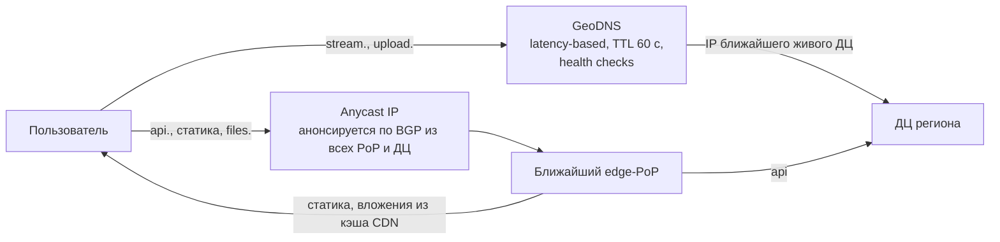
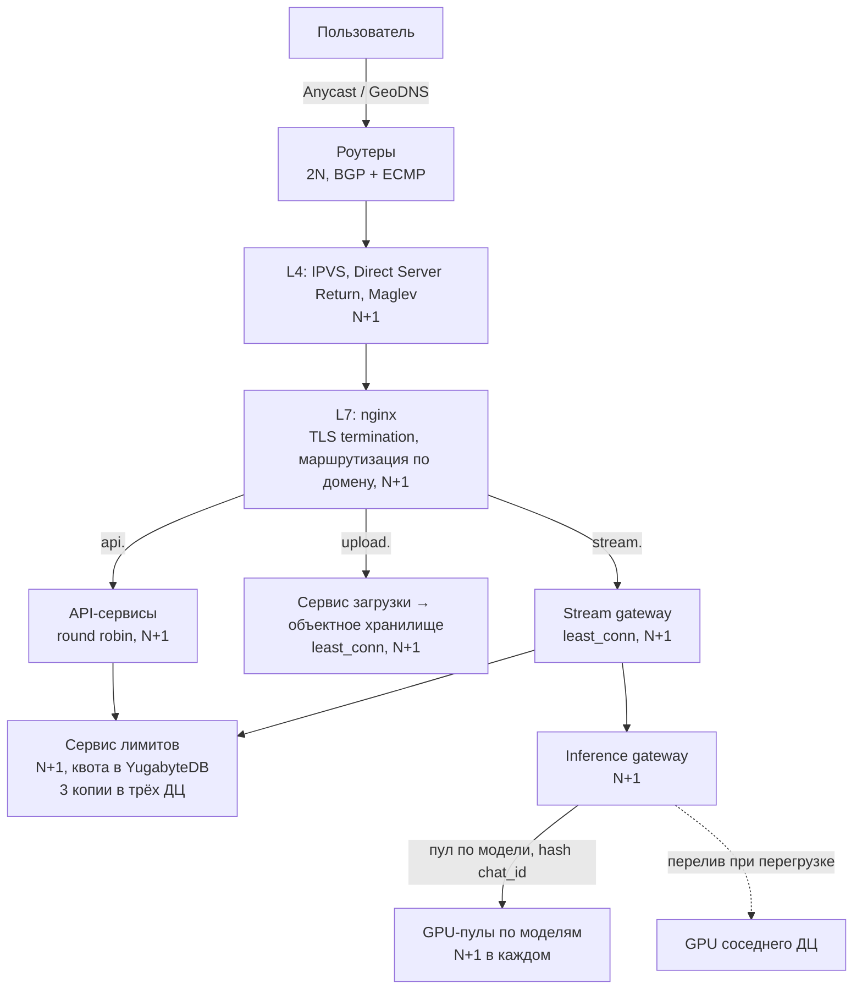
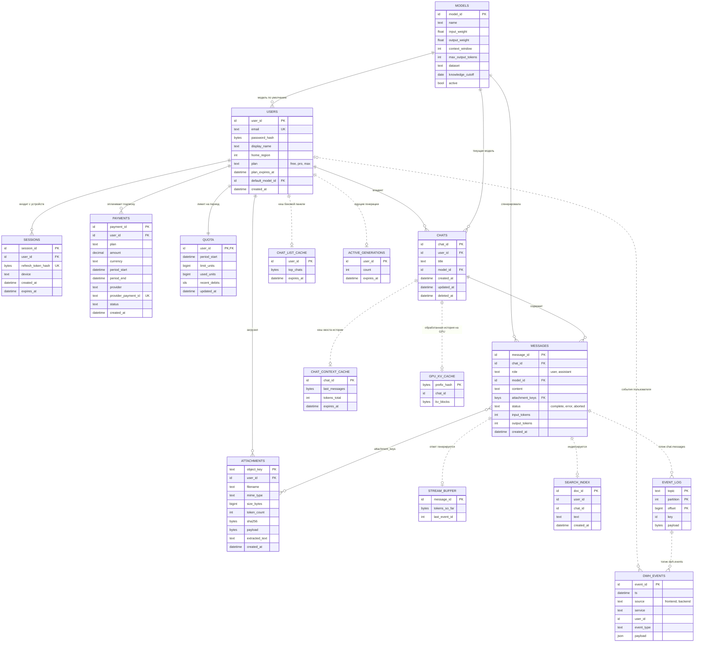
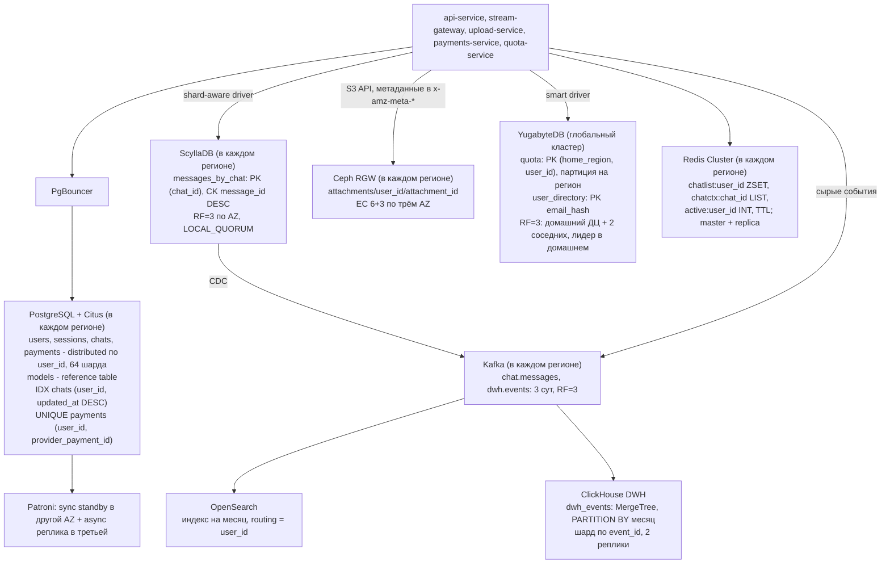
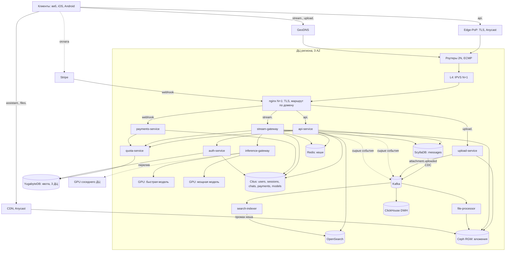

# highloadDZ2026

Домашнее задание по курсу "Проектирование высоконагруженных систем".

## 1. Тема и целевая аудитория

В данной работе будет спроектирована архитектура сервиса-ассистента на базе больших языковых моделей - по образцу Claude от Anthropic. Прямые рыночные аналоги - ChatGPT от OpenAI и Gemini от Google - подтверждают существование ниши и её масштаб: это один из самых быстрорастущих типов потребительских сервисов за последние годы.

Целевая аудитория - массовый пользователь веба и мобильных приложений по всему миру (частные лица и сотрудники компаний). По данным отчёта Sensor Tower "State of AI 2026" [1], у Claude около 245 млн месячных активных пользователей на web и mobile. Такой масштаб аудитории в сочетании с тем, что каждый запрос требует дорогого инференса на GPU (а не просто отдачи статики или строки из БД), делает архитектуру сервиса нетривиальной: нагрузка высока и по RPS на бекенд, и по вычислениям на кластере инференса.

## Функционал MVP

Ключевые функции, вокруг которых будет проектироваться система:

1. Отправка сообщения и потоковое (Token-by-token, TBT) получение ответа модели
2. Хранение истории переписки на сервере и список чатов пользователя
3. Синхронизация чатов между несколькими устройствами одного пользователя
4. Подсчёт токенов запроса и ответа и управление лимитами: размер квоты на период зависит от оплаченной подписки, пользователь видит остаток, при превышении генерация блокируется до конца периода
5. Прикрепление файлов к сообщению (изображения, документы, PDF)
6. Выбор модели под задачу (быстрая и дешёвая vs более мощная и дорогая - напрямую влияет на расход токен-лимита)

## Ключевые продуктовые решения

- История чатов хранится на сервере, а не только на клиенте (в отличие, например, от WhatsApp) - это нужно для синхронизации между устройствами и доступа с любого клиента
- Ответ модели отдаётся потоково через SSE/WebSocket, а не единым блоком по готовности - снижает воспринимаемую задержку (Time to First Byte, TTFB), критичную при долгом инференсе
- Инференс-кластер отделён от основного бекенда и масштабируется независимо: именно GPU-инференс, а не запросы к БД, является главным потребителем ресурсов и основным источником нагрузки
- Лимиты считаются в токенах с учётом веса модели, а не в запросах: у пользователя одна квота на период (окно 5 ч или неделя - по тарифу). Остаток проверяется перед генерацией, а списание - одна запись в один счётчик после ответа, когда точно известно число входных и выходных токенов. Возможный перерасход ограничен заранее (п. 7.1)
- Квота пользователя - это просто число без персональных данных, поэтому она хранится сразу в трёх ДЦ и переживает отказ любого из них. Ходить за ней через океан (100-250 мс) допустимо на фоне ~20 с генерации ответа
- Подписка оплачивается через внешнего платёжного провайдера, у нас хранится история платежей; данные карт мы не храним

## 2. Расчёт нагрузки

Anthropic не публикует DAU, интенсивность использования, объём хранения и RPS. Сделаем некоторую аппроксимацию - калибруемся по конкуренту (ChatGPT), у которого есть публичные цифры:

- MAU ChatGPT = 1 млрд (июнь 2026, Reuters)
- WAU ChatGPT = >1 млрд (31 июля 2026, подтверждено OpenAI [3])
- 2.5 млрд запросов/сутки глобально (OpenAI, июль 2025 [4])

Отсюда интенсивность: `2.5 млрд / 1 млрд MAU = 2.5` сообщения в сутки на одного MAU-пользователя - это будет ориентиром. Применяем его к аудитории Claude: `245 млн × 2.5 ≈ 612.5 млн` сообщений в сутки, на одного DAU - `612.5 млн / 49 млн ≈ 12.5`.

Размеры сообщений берём из открытого датасета реальных диалогов ShareChat [5]: запрос в среднем ~135 токенов, ответ ~1 115 токенов, в диалоге с Claude в среднем 4.49 сообщения. Принимаем 1 токен ≈ 4 байта текста (UTF-8, преимущественно латиница).

Остальные допущения - по ним публичных цифр нет даже у ChatGPT:

- DAU/MAU = 20% (в СМИ для ChatGPT называют ~190-210 млн DAU при ~1 млрд MAU - тот же порядок, но это не первоисточник, поэтому используем только как сверку)
- Частота второстепенных действий (список чатов, поиск, вложения, смена модели) задана как пропорция от отправки сообщений
- Пик/среднее = x4 (глобальная аудитория размазывает суточный пик по часовым поясам сильнее, чем у локального сервиса, но вечерние пики US+Европа всё равно накладываются)
- Вложение в среднем 0.5 МБ, каждое просматривается из истории ~2 раза

Основные формулы:

```
DAU                  = MAU × 0.2
Сообщений/сутки      = MAU × 2.5
N_тип/сутки          = DAU × (действий этого типа на пользователя в день)
RPS_средний          = N_тип/сутки / 86 400
RPS_пиковый          = RPS_средний × 4
V_сутки              = N/сутки × размер объекта
Трафик, Гбит/с       = V_сутки × 8 / 86 400
Прирост за год       = V_сутки × 365
Прирост на польз/год = V_сутки × 365 / DAU
```

### Продуктовые метрики

| Метрика                                  | Значение            |
| ---------------------------------------- | ------------------- |
| MAU                                      | 245 млн             |
| DAU                                      | ~49 млн             |
| Прирост хранилища на пользователя за год | ~170 МБ             |
| — сообщения (пары запрос-ответ)          | ~4 560 шт / ~23 МБ  |
| — чаты                                   | ~1 020 шт / ~0.5 МБ |
| — вложения                               | ~290 шт / ~146 МБ   |
| Отправка сообщения                       | ~12.5 шт/день       |
| Открытие списка чатов / истории чата     | ~8 шт/день          |
| Просмотр вложения из истории             | ~1.6 шт/день        |
| Прикрепление файла                       | ~0.8 шт/день        |
| Смена модели                             | ~0.5 шт/день        |
| Поиск по истории                         | ~0.3 шт/день        |

### Хранение (суточный прирост)

Для хранения важнее не накопленный объём на пользователя, а скорость прироста:

- Сообщения: `612.5 млн × (135 + 1 115) токенов × 4 Б ≈ 612.5 млн × 5 КБ ≈ 3.06 ТБ/сутки`
- Чаты: `612.5 млн / 4.49 ≈ 136 млн` новых чатов в сутки, метаданные ~0.5 КБ
- Токены отдельно не хранятся: число входных и выходных токенов - два поля в строке ответа модели (+8 Б к сообщению)
- Вложения: `49 млн × 0.8 × 0.5 МБ ≈ 19.6 ТБ/сутки`

| Тип данных       | Объектов/сутки | Объём/сутки | Прирост/год |
| ---------------- | -------------- | ----------- | ----------- |
| Сообщения        | 612.5 млн      | ~3.06 ТБ    | ~1.1 ПБ     |
| Метаданные чатов | 136 млн        | ~0.07 ТБ    | ~25 ТБ      |
| Вложения         | 39.2 млн       | ~19.6 ТБ    | ~7.2 ПБ     |
| Итого            | -              | ~22.7 ТБ    | ~8.3 ПБ     |

### Токены (нагрузка на учёт лимитов и инференс)

На вход модели уходит не только новое сообщение, но и история чата: в среднем перед сообщением в чате `(4.49 - 1) / 2 ≈ 1.75` предыдущих пар, т.е. `135 + 1.75 × 1 250 ≈ 2 325` входных токенов на запрос.

| Тип токенов               | Среднее, токенов/с | Пик, токенов/с |
| ------------------------- | ------------------ | -------------- |
| Входные (с историей чата) | ~16.5 млн          | ~66 млн        |
| Выходные                  | ~7.9 млн           | ~31.6 млн      |

### Сетевой трафик

- Стриминг ответа: SSE-событие на ~4 токена, ~100 Б обвязки на событие → `1 115 / 4 × 100 Б + 4.5 КБ ≈ 32.5 КБ`, плюс запрос ~1.5 КБ ⇒ ~34 КБ на сообщение
- Список чатов / история чата: ~10 КБ (gzip)
- Вложения раздаются через CDN

| Тип трафика            | Объём/сутки | Средний, Гбит/с | Пиковый, Гбит/с |
| ---------------------- | ----------- | --------------- | --------------- |
| Стриминг сообщений     | ~20.8 ТБ    | ~1.9            | ~7.7            |
| Загрузка вложений      | ~19.6 ТБ    | ~1.8            | ~7.3            |
| Раздача вложений (CDN) | ~39.2 ТБ    | ~3.6            | ~14.5           |
| Список чатов / история | ~3.9 ТБ     | ~0.4            | ~1.5            |
| Итого                  | ~83.5 ТБ    | ~7.7            | ~31             |

### RPS по типам запросов

| Тип запроса                          | Запросов/сутки | RPS средний | RPS пиковый |
| ------------------------------------ | -------------- | ----------- | ----------- |
| Отправка сообщения (chat completion) | 612.5 млн      | ~7 090      | ~28 360     |
| Проверка лимита (чтение)\*           | 612.5 млн      | ~7 090      | ~28 360     |
| Списание лимита (запись)\*           | 612.5 млн      | ~7 090      | ~28 360     |
| Список чатов / история               | 392 млн        | ~4 540      | ~18 160     |
| Просмотр вложения (CDN)              | 78.4 млн       | ~910        | ~3 640      |
| Прикрепление файла                   | 39.2 млн       | ~450        | ~1 800      |
| Смена модели                         | 24.5 млн       | ~280        | ~1 120      |
| Поиск по истории                     | 14.7 млн       | ~170        | ~680        |

\* внутренние запросы, по одному на сообщение: остаток читается перед генерацией, списание - одна запись в счётчик после ответа (п. 7.1)

## 3. Глобальная балансировка нагрузки

### Функциональное разбиение по доменам

| Домен                      | Назначение                                                 | Балансировка |
| -------------------------- | ---------------------------------------------------------- | ------------ |
| `assistant.example`        | Веб-клиент, статика                                        | CDN, Anycast |
| `api.assistant.example`    | Список чатов, история, поиск, смена модели, остаток лимита | Anycast      |
| `stream.assistant.example` | Отправка сообщения и SSE-стриминг ответа                   | GeoDNS       |
| `upload.assistant.example` | Загрузка вложений                                          | GeoDNS       |
| `files.assistant.example`  | Раздача вложений                                           | CDN, Anycast |

Короткие stateless-запросы (`api`, статика, файлы) идут через Anycast: смена BGP-маршрута посреди запроса им почти не страшна. Долгие соединения (`stream` - ~20 с на ответ, `upload`) идут через GeoDNS, чтобы соединение гарантированно оставалось в одном ДЦ.

### Расположение ДЦ

По данным Anthropic Economic Index [6] на США приходится 21.6% использования Claude.ai, дальше идут Индия (~7%), Бразилия, Япония и Южная Корея (по ~3.5%); использование сильно коррелирует с ВВП на душу населения, поэтому значимая доля - у Европы. Точного разбиения по регионам нет, поэтому доли ниже - оценка:

| ДЦ                  | Обслуживаемые регионы                      | Доля (оценка) |
| ------------------- | ------------------------------------------ | ------------- |
| US-East (Вирджиния) | Восток Северной Америки, Латинская Америка | 25%           |
| US-West (Орегон)    | Запад Северной Америки                     | 11%           |
| Франкфурт           | Европа, Ближний Восток, Африка             | 34%           |
| Сингапур            | Южная и Юго-Восточная Азия, Океания        | 18%           |
| Токио               | Восточная Азия                             | 12%           |

Обоснование:

- GPU-кластеры требуют много электроэнергии, поэтому ставим крупные ДЦ в пяти регионах, а не в каждой стране; ближе к пользователям - edge-PoP (CDN и TLS-терминация)
- Влияние на продуктовые метрики: трансокеанский RTT 150-250 мс против <50 мс внутри региона добавляется ко времени до первого токена (TTFT) и особенно заметен на запросах `api` (открытие списка чатов, истории). Сам стриминг от RTT почти не зависит
- Европа выделена отдельно ещё и из-за GDPR: чаты пользователей ЕС хранятся в ЕС. Резервные копии данных ЕС хранятся на отдельной площадке в Амстердаме - только хранилище бэкапов, без GPU и пользовательского трафика
- Латинская Америка обслуживается из US-East (~120 мс до Сан-Паулу - приемлемо для LLM-сервиса), статика - с локального edge-PoP
- Каждый ДЦ состоит из трёх зон доступности (AZ) - отдельных зданий с независимым питанием и связью; на этом строится резервирование внутри ДЦ (п. 6, 9)

### Распределение запросов по ДЦ (пик)

`Пик_ДЦ = Пик_глобальный × доля ДЦ`. Трафик через ДЦ - без раздачи вложений (её берёт на себя CDN): `7.7 + 7.3 + 1.5 ≈ 16.4 Гбит/с`.

| ДЦ        | Отправка сообщения | Список чатов / история | Загрузка файлов | Трафик, Гбит/с |
| --------- | ------------------ | ---------------------- | --------------- | -------------- |
| US-East   | 7 090              | 4 540                  | 450             | ~4.1           |
| US-West   | 3 120              | 2 000                  | 200             | ~1.8           |
| Франкфурт | 9 640              | 6 170                  | 610             | ~5.6           |
| Сингапур  | 5 100              | 3 270                  | 320             | ~3.0           |
| Токио     | 3 400              | 2 180                  | 220             | ~2.0           |

### Схема DNS и Anycast балансировки



### Регулировка трафика между ДЦ

- Отключение ДЦ (авария или работы): снимаем BGP-анонс Anycast-адресов и убираем ДЦ из ответов GeoDNS - за ~TTL (60 с) новые соединения уходят в соседний ДЦ
- Перелив инференса: если в ДЦ перегружены GPU (растёт очередь, нарушается SLO по TTFT), inference gateway отправляет генерацию в соседний ДЦ по магистральной сети - лишние ~100 мс незаметны на фоне ~20 с генерации. Тяжёлые модели могут быть развёрнуты не во всех ДЦ - тогда запрос маршрутизируется туда, где модель есть
- Токен-лимиты: счётчик квоты пользователя хранится в трёх ДЦ - домашнем и двух ближайших (п. 6). Главная копия (лидер) - в домашнем ДЦ, поэтому обычно проверка остатка локальная. Если пользователь пишет из другого региона, запрос к квоте идёт через океан, это +100-250 мс на фоне ~20 с генерации. При отказе домашнего ДЦ лидером становится копия в соседнем, подтверждённые списания не теряются

## 4. Локальная балансировка нагрузки

### Схема балансировки



| Уровень                | Резервирование                | Почему                                                                                 |
| ---------------------- | ----------------------------- | -------------------------------------------------------------------------------------- |
| Роутеры                | 2N                            | Отказ роутера отключает весь ДЦ                                                        |
| L4 (IPVS)              | N+1                           | Узлы взаимозаменяемы; Maglev даёт одинаковый выбор L7 на всех L4, соединения не рвутся |
| L7 (nginx)             | N+1                           | Отказ узла снижает только общую мощность                                               |
| API, stream gateway, сервис лимитов | N+1              | Сервисы без состояния, отказ узла снижает только общую мощность                        |
| Квота (YugabyteDB)     | 3 копии в трёх ДЦ, кворум 2 из 3 | Потеря счётчика = либо бесплатные токены, либо ложные блокировки; переживает отказ целого ДЦ |
| GPU-пулы               | N+1 на каждую модель          | Отказ узла не должен делать модель недоступной                                         |

Алгоритмы: роутеры → L4 - ECMP; L4 → L7 - Maglev (consistent hashing по 5-tuple); `api` - round robin (короткие запросы); `stream` и `upload` - least_conn (долгие соединения); inference gateway → GPU - сначала пул нужной модели, внутри пула consistent hashing по `chat_id` с ограничением нагрузки (п. 7.2).

L4 работает в режиме Direct Routing: подменяет у пакета только MAC-адрес, поэтому L4 и nginx стоят в одном L2-сегменте. Если они окажутся в разных подсетях, используется IP-туннель (IPIP): пакет заворачивается в новый IP-пакет и доходит через роутеры. В обоих режимах ответ идёт клиенту напрямую, мимо L4.

### Расчёт количества балансировщиков

Пиковый внешний RPS через L7 (без CDN и внутренних проверок лимита): `28 360 + 18 160 + 1 800 + 1 120 + 680 ≈ 50 120`. Оценка сверху: каждый запрос открывает новое TLS-соединение, а запросы `api.` считаются так, как будто идут в ДЦ напрямую. В штатном режиме рукопожатия `api.` делает edge, и в ДЦ они приходят по постоянным соединениям - этот объём остаётся запасом на случай недоступности edge.

- SSL termination, данные 2017 г. (RSA-2048) [7]: 428 CPS на ядро; масштабирование упирается в ~10 000 CPS на сервер (24 ядра) ⇒ `50 120 / 428 ≈ 117` ядер глобально
- SSL termination, данные 2019 г. [8]: 4 433 TPS на ядро ⇒ `50 120 / 4 433 ≈ 12` ядер - считаем по более строгим данным 2017 г.
- Обработка HTTPS-запросов (1 КБ) [8]: 28 640 RPS на ядро ⇒ ~2 ядра - не ограничитель
- Одновременные SSE-стримы: ответ длится `1 115 токенов / ~60 токенов/с + ~1 с TTFT ≈ 20 с` ⇒ `28 360 × 20 ≈ 570 тыс.` открытых соединений глобально (во Франкфурте ~190 тыс.). nginx держит сотни тысяч соединений на сервер - не ограничитель, но `worker_connections` нужно поднять
- Сеть: максимум во Франкфурте ~5.6 Гбит/с, сервер с 25 GbE при загрузке 70% - 17.5 Гбит/с - не ограничитель
- L4 в режиме DSR пропускает только входящий трафик (запросы и загрузки, ~7.6 Гбит/с глобально) - не ограничитель, ставим по 2 на ДЦ

`Серверов nginx = ⌈Пиковый RPS ДЦ / 10 000⌉ + 1`

| ДЦ        | Пиковый RPS | Ядер на TLS | Серверов nginx | Серверов L4 | Роутеров |
| --------- | ----------- | ----------- | -------------- | ----------- | -------- |
| US-East   | 12 530      | 30          | 3 (+1)         | 2           | 2        |
| US-West   | 5 510       | 13          | 2              | 2           | 2        |
| Франкфурт | 17 040      | 40          | 3 (+1)         | 2           | 2        |
| Сингапур  | 9 020       | 22          | 2              | 2           | 2        |
| Токио     | 6 010       | 15          | 2              | 2           | 2        |

US-East и Франкфурт резервируют друг друга: при отказе одного второй получает `12 530 + 17 040 ≈ 29 600 RPS` ⇒ 3 рабочих сервера, поэтому для сохранения N+1 в аварии добавляем им по одному серверу (+1). Итого: 14 серверов nginx, 10 серверов L4, 10 роутеров.

### Межсервисные запросы

После nginx сервисы общаются между собой внутри ДЦ. Отдельного балансировщика между ними нет:

- **Протокол - gRPC (HTTP/2).** Одно долгое соединение, по нему параллельно идёт много запросов. Потоковые вызовы нужны, чтобы inference gateway передавал токены в stream gateway по мере генерации
- **Service discovery** - Kubernetes и Istio: каждый экземпляр сервиса регистрируется при старте, вызывающая сторона получает список живых экземпляров. Упавший экземпляр из списка пропадает
- **Балансировка на стороне клиента** - sidecar Envoy рядом с каждым сервисом сам выбирает экземпляр для каждого запроса. Обычный L4 здесь не подходит: он балансирует соединения, и все запросы по одному долгому gRPC-соединению ушли бы на один экземпляр
- **mTLS** между сервисами делает Envoy, код сервисов шифрованием не занимается

| Откуда → куда                                      | Алгоритм                                                                                   |
| -------------------------------------------------- | ------------------------------------------------------------------------------------------ |
| API / stream gateway → сервис лимитов              | Round robin; сервис лимитов сам идёт в YugabyteDB к лидеру строки пользователя (п. 6)       |
| Сервисы → PostgreSQL / ScyllaDB / Redis            | Через драйверы с учётом шардов: запрос идёт сразу на узел-владелец ключа (п. 6.5)          |
| Stream gateway → inference gateway                 | Least request: генерации разной длины, запрос идёт туда, где меньше активных               |
| Inference gateway → GPU                            | Пул нужной модели, внутри - consistent hashing по `chat_id` с ограничением нагрузки (п. 7.2) |
| Сервис загрузки → объектное хранилище              | Round robin по шлюзам Ceph RGW                                                             |

Надёжность вызовов: таймаут на каждый вызов; повторы с растущей паузой только для идемпотентных операций; circuit breaker (outlier detection в Envoy) временно исключает экземпляр, который стабильно отвечает ошибками. Генерацию вслепую не повторяем: повтор с тем же `message_id` не запускает вторую генерацию и не списывает лимит дважды.

## 5. Логическая схема БД

ID всех сущностей - 64-битные Snowflake-идентификаторы (время + номер региона + счётчик): они упорядочены по времени создания, а по `user_id` сразу видно домашний регион пользователя. Данные пользователя хранятся в его домашнем регионе (GDPR, п. 3). Исключение - квота: это просто число без персональных данных, поэтому она хранится сразу в трёх ДЦ. Объёмы считаются на горизонте 1 год, как прирост в п. 2.

### 5.1. Логическая схема

Основные данные, файлы, кеши и буферы - на одной схеме. Сплошные линии - связи по внешнему ключу. Пунктир - связи без внешнего ключа: кеши, буферы и индексы - производные копии основных данных, связанные с ними по ID.



| Таблица              | Назначение                                                                                                                                                                 |
| -------------------- | -------------------------------------------------------------------------------------------------------------------------------------------------------------------------- |
| `USERS`              | Аккаунт, домашний регион, модель по умолчанию и **текущая подписка** (`plan`, `plan_expires_at`). Подписка у пользователя одна, поэтому отдельной сущности тарифа с суррогатным ключом нет: параметры трёх тарифов (размер квоты, окно, доступные модели) - конфигурация сервиса лимитов |
| `SESSIONS`           | Refresh-токены устройств; access-токен (JWT) живёт 15 мин и проверяется по подписи без БД                                                                                   |
| `PAYMENTS`           | История платежей за подписку. Сами платежи проводит внешний провайдер (Stripe [24]), у нас - его ID платежа, сумма, период и статус                                          |
| `QUOTA`              | **Одна строка на пользователя** - счётчик лимита за текущий период: лимит и израсходовано в единицах. Списание - одно обновление этой строки после ответа модели (п. 7.1)    |
| `MODELS`             | Справочник моделей: веса для пересчёта токенов в единицы лимита, размер контекста, **датасет обучения** и дата среза знаний                                               |
| `CHATS`              | Чат: заголовок, текущая модель, время последнего сообщения - по нему сортируется боковая панель                                                                             |
| `MESSAGES`           | Сообщение пользователя или ответ модели. В ответе - число входных и выходных токенов: записываются **один раз**, когда ответ готов. Ссылки на вложения - список ключей объектов |
| `ATTACHMENTS`        | Вложение целиком: файл и его метаданные в одном объекте хранилища, ключ - `object_key`. Объект не знает, в каком сообщении он используется: связь хранится на стороне сообщения |
| `DWH_EVENTS`         | Сырые события фронтенда и бэкенда одной таблицей, без разделения на типы: клики, просмотры, логи сервисов. Для аналитики и разбора проблем                                 |
| `CHAT_LIST_CACHE`    | Последние 50 чатов пользователя для боковой панели                                                                                                                         |
| `CHAT_CONTEXT_CACHE` | Хвост истории активного чата - нужен на каждое новое сообщение, чтобы собрать запрос к модели; TTL 1 ч                                                                     |
| `STREAM_BUFFER`      | Уже сгенерированная часть ответа - чтобы клиент при обрыве переподключился и дочитал (`Last-Event-ID`)                                                                     |
| `SEARCH_INDEX`       | Полнотекстовый индекс по названиям чатов и сообщениям пользователя                                                                                                         |
| `EVENT_LOG`          | Очередь событий: новые сообщения (для поиска и восстановления после сбоя), сырые события для DWH                                                                           |
| `GPU_KV_CACHE`       | Обработанная моделью история чата в памяти GPU и оперативной памяти GPU-узла; теряется без последствий (п. 7.2)                                                            |
| `ACTIVE_GENERATIONS` | Число генераций пользователя, идущих прямо сейчас: ограничивает параллельные ответы и тем самым перерасход лимита (п. 7.1)                                                  |

Лимит считается в условных единицах: `units = input_tokens × input_weight + output_tokens × output_weight`. Веса берутся из `MODELS`, поэтому ответ мощной модели "стоит" больше - так выбор модели напрямую влияет на расход лимита. Общий расход пользователя - производная от `input_tokens` и `output_tokens` его сообщений: в счётчике `QUOTA` он уже просуммирован за период, отдельный журнал не нужен.

Счётчика сообщений в `CHATS` нет: он дублировал бы данные `MESSAGES`, добавлял бы ещё одно изменение строки на каждое сообщение и ни одному сценарию MVP не нужен. Число сообщений при необходимости считается по истории чата, которая и так читается целиком.

Продуктовое решение для поиска: индексируем только названия чатов и сообщения пользователя, без ответов модели. Ответы в ~8 раз длиннее, индекс по ним стоил бы ~1 ПБ в год, а свой чат почти всегда находят по своему вопросу.

### 5.2. Размеры и нагрузка

Допущения (в дополнение к п. 2):

- Аккаунтов ~500 млн (~2×MAU, много неактивных), активных сессий ~370 млн (~1.5 устройства на MAU)
- Платную подписку оплачивают ~5% MAU помесячно: 12.25 млн платежей в месяц
- Открытия списка чатов и истории чата (8/день на DAU) делятся пополам: пик по 9 080/с
- Новых чатов `612.5 млн / 4.49 ≈ 136 млн/сутки` → пик ~6 300/с; обновление токена - 2 раза в день на DAU → пик ~4 540/с
- Попадание в кеш: список чатов и чат - 80%, история чата - 50%, контекст для генерации - 80% (у первого сообщения чата - 22% всех сообщений - контекста нет)
- DWH: на каждое действие пользователя приходится ~10 сырых событий (события фронтенда и логи каждого сервиса на пути запроса) по ~300 Б

Нагрузка - глобальный пик (×4 от среднего).

| Таблица       | Строк (1 год) | Байт/строка            | Объём                             | Чтение, QPS        | Запись, QPS           |
| ------------- | ------------- | ---------------------- | --------------------------------- | ------------------ | --------------------- |
| `USERS`       | 500 млн       | 300                    | 0.15 ТБ                           | 4 540              | 1 170                 |
| `SESSIONS`    | 370 млн       | 200                    | 0.07 ТБ                           | 4 540              | 4 540                 |
| `PAYMENTS`    | 147 млн       | 300                    | 44 ГБ                             | ~10                | ~40                   |
| `QUOTA`       | 245 млн       | 128                    | 31 ГБ                             | 37 440             | 28 360                |
| `MODELS`      | ~20           | 300                    | ~6 КБ                             | <10 (в памяти)     | ~0                    |
| `CHATS`       | 49.6 млрд     | 500                    | 24.8 ТБ                           | 3 640              | 42 080                |
| `MESSAGES`    | 447 млрд      | 2 500                  | 1.12 ПБ                           | 8 960              | 56 720                |
| `ATTACHMENTS` | 14.3 млрд     | 0.5 МБ + 20 КБ текста  | ~7.4 ПБ                           | 3 600              | 3 600                 |
| `DWH_EVENTS`  | 4.2 трлн      | 300                    | 1.27 ПБ сырых, ~127 ТБ после сжатия | десятки аналитических | 537 000 (пачками) |

Откуда цифры:

- `USERS`: чтение при входе и обновлении токена (4 540); запись - смена модели по умолчанию (1 120), регистрации (~25), смена тарифа после оплаты (~20)
- `PAYMENTS`: `12.25 млн / 30 / 86 400 × 4 ≈ 19` платежей/с в пике, у каждого 2 записи: создание и подтверждение по webhook провайдера
- `QUOTA`: чтение = проверка остатка перед каждой генерацией 28 360 + показ остатка вместе со списком чатов 9 080. Запись - **одно** списание на ответ: 28 360. Строка маленькая, вся таблица - 31 ГБ
- `CHATS`: запись = новый чат 6 300 + обновление `updated_at` на каждое сообщение 28 360 + автоматический заголовок 6 300 + смена модели 1 120. Чтение = `(9 080 + 9 080) × 20%` промахов кеша
- `MESSAGES`: две вставки на обмен: сообщение пользователя при отправке и ответ модели - один раз, когда он готов и токены посчитаны: `2 × 28 360 = 56 720`. Чтение = история `9 080 × 50%` + контекст для генерации `28 360 × 78% × 20%` ≈ 8 960 запросов (каждый - выборка ~10 строк)
- `ATTACHMENTS`: запись = 1 800 файлов + 1 800 извлечённых текстов; чтение = промахи CDN `3 640 × 50%` + чтение извлечённого текста при сборке запроса к модели ~1 800
- `DWH_EVENTS`: `1.16 млрд действий/сутки × 10 = 11.6 млрд` событий в сутки → 134 тыс./с в среднем, 537 тыс./с в пике; `11.6 млрд × 300 Б ≈ 3.5 ТБ/сутки` сырых, ClickHouse сжимает такие данные примерно в 10 раз

| Кеши и буферы        | Количество и размер                                      | Объём       | Пиковое чтение / запись           |
| -------------------- | -------------------------------------------------------- | ----------- | --------------------------------- |
| `CHAT_LIST_CACHE`    | 49 млн DAU × 5 КБ                                        | ~245 ГБ     | 9 080 / 42 080                    |
| `CHAT_CONTEXT_CACHE` | ~50 млн чатов, активных за час, × 10 КБ                  | ~500 ГБ     | 28 360 / 56 720                   |
| `STREAM_BUFFER`      | 570 тыс. одновременных ответов × 5 КБ                    | ~2.9 ГБ     | дописывается в памяти gateway     |
| `ACTIVE_GENERATIONS` | до 570 тыс. счётчиков × 16 Б                             | ~9 МБ       | 28 360 / 56 720 (+1 и −1)         |
| `SEARCH_INDEX`       | `(612.5 млн × 0.6 КБ + 136 млн × 0.1 КБ) × 1.5` в сутки  | ~210 ТБ/год | 680 / 34 660 документов/с         |
| `EVENT_LOG`          | `chat.messages` - 3 сут × 3.06 ТБ, `dwh.events` - 3 сут × 3.5 ТБ | ~20 ТБ | 56 720 + 537 000 событий/с     |
| `GPU_KV_CACHE`       | в памяти GPU-узлов (п. 7.2)                              | -           | на каждую генерацию               |

Все объёмы логические, без реплик и индексов (физические - в п. 6).

### 5.3. Консистентность и распределение нагрузки по ключам

| Данные                   | Требование к консистентности                                                                                                                                                       | Распределение нагрузки по ключам                                                                                         |
| ------------------------ | ---------------------------------------------------------------------------------------------------------------------------------------------------------------------------------- | ------------------------------------------------------------------------------------------------------------------------ |
| `USERS`, `SESSIONS`      | Строгая: уникальный email, отзыв сессии действует сразу                                                                                                                            | Равномерно по `user_id`                                                                                                  |
| `PAYMENTS`               | Строгая. Провайдер может прислать webhook несколько раз - повтор узнаётся по уникальному `provider_payment_id`. Статус платежа и тариф в `USERS` меняются в одной транзакции       | По `user_id`, нагрузка мала                                                                                               |
| `QUOTA`                  | Строгая на строку: проверка читает главную копию, списание - атомарное `used = used + units`, параллельные списания не теряются. Подтверждённое списание переживает отказ целого ДЦ. Повтор списания распознаётся по `recent_debits`. Перерасход ограничен заранее (п. 7.1) | По `user_id`. Горячих строк нет: нагрузку одного пользователя ограничивают сам лимит и не больше 3 параллельных генераций |
| `MESSAGES`, `CHATS`      | Read-your-writes для автора (своё сообщение видно сразу); на другом устройстве - итоговая, до 1-2 с. Порядок в чате - по `message_id`; в одном чате одновременно идёт одна генерация | По `chat_id` / `user_id`. Размер одного чата ограничен окном контекста модели (~200 тыс. токенов ≈ 1 МБ)                |
| `ATTACHMENTS`            | Файл и метаданные записываются одной операцией. Сообщение ссылается только на уже записанный объект. Загруженные, но не отправленные файлы удаляются через 24 ч                    | Ключ объекта неизменяемый, распределение по хешу                                                                         |
| `DWH_EVENTS`             | Итоговая, доставка at-least-once: редкие дубли для аналитики допустимы                                                                                                             | Только добавление, шардирование по хешу                                                                                  |
| Кеши, `SEARCH_INDEX`     | Итоговая: контекст чата обновляется сразу после записи сообщения в БД, список чатов - с TTL, поиск отстаёт до ~1 мин                                                               | По `user_id` / `chat_id`                                                                                                 |
| `ACTIVE_GENERATIONS`     | Приблизительная: если сервис упал и не уменьшил счётчик, его исправит TTL (2 мин)                                                                                                  | По `user_id`                                                                                                             |

Общие особенности распределения:

- Все записи идут "в текущий момент" - поэтому основные таблицы шардируются не по времени (весь поток записи попал бы на один шард), а по хешу `user_id` / `chat_id`. Время используется только для разбиения на партиции и удаления старых данных
- Нагрузка по регионам повторяет доли из п. 3: Франкфурт хранит и обслуживает ~34% пользовательских данных
- Справочник `MODELS` читается на каждый запрос, поэтому держится в памяти сервисов

## 6. Физическая схема БД

### 6.1. Выбор СУБД

| Данные                                                 | СУБД                          | Почему                                                                                                                                                                                                                                 |
| ------------------------------------------------------ | ----------------------------- | -------------------------------------------------------------------------------------------------------------------------------------------------------------------------------------------------------------------------------------- |
| `USERS`, `SESSIONS`, `CHATS`, `PAYMENTS`, `MODELS`     | PostgreSQL + Citus            | Нужны транзакции (платёж и тариф меняются вместе), уникальность email и `provider_payment_id`, индекс с сортировкой по изменяемому полю `updated_at` для списка чатов. Citus шардирует таблицы по `user_id` [11]                          |
| `MESSAGES`                                             | ScyllaDB                      | Самая большая таблица (~1.1 ПБ/год) и ~57 тыс. вставок/с; доступ только по ключу `chat_id` без JOIN. Строки партиции отсортированы по `message_id`, история чата читается одним запросом. Так же хранит сообщения Discord [9]             |
| `ATTACHMENTS`                                          | Ceph RGW (S3 API)             | Петабайты файлов. Метаданные хранятся в самом объекте как пользовательские поля S3 (`x-amz-meta-*`) [23]: файл и метаданные пишутся одной операцией. Erasure coding вместо тройной копии [15]                                            |
| `QUOTA`                                                | YugabyteDB, глобальный кластер | Строгая консистентность и копии в нескольких ДЦ: Raft-репликация, запись подтверждается кворумом из двух ДЦ. Строки привязываются к региону: главная копия - в домашнем ДЦ, остальные - в соседних [18, 19]. PostgreSQL-совместимый SQL |
| `DWH_EVENTS`                                           | ClickHouse                    | Только добавление, сотни тысяч строк в секунду пачками, аналитические запросы по миллиардам строк, сжатие в 5-10 раз [13]. Загружает события прямо из Kafka [14]                                                                         |
| `CHAT_LIST_CACHE`, `CHAT_CONTEXT_CACHE`, `ACTIVE_GENERATIONS` | Redis Cluster          | Данные в памяти, TTL, атомарные `INCR`/`DECR`, список и сортированное множество из коробки [12]                                                                                                                                          |
| `SEARCH_INDEX`                                         | OpenSearch                    | Полнотекстовый поиск                                                                                                                                                                                                                   |
| `EVENT_LOG`                                            | Kafka                         | Надёжная очередь с повторным чтением; сообщения попадают в неё из CDC ScyllaDB, без двойной записи [22]                                                                                                                                 |
| `STREAM_BUFFER`                                        | Память stream gateway         | Буфер живёт ~20 с; переподключение клиента идёт на тот же gateway (hash по `message_id`)                                                                                                                                              |
| `GPU_KV_CACHE`                                         | Память GPU и узла (движок инференса) | Управляется движком TensorRT-LLM [26]                                                                                                                                                                                         |

Почему квота не в Redis: Redis реплицирует асинхронно и в пределах одного ДЦ. При отказе ДЦ квоты его пользователей пропали бы, а при переключении на реплику терялись бы последние списания. Квота - маленькое число на пользователя (31 ГБ на всех), и на неё приходится одна запись на ответ (п. 7.1), поэтому держать её в геораспределённой БД со строгой консистентностью дёшево.

### 6.2. Схема

Пользовательские данные развёрнуты в каждом регионе отдельно. Глобальный только кластер YugabyteDB: квота и справочник `user_directory` (по хешу email определяется домашний регион при входе).



### 6.3. Таблицы, индексы, шардирование и резервирование

`home_region` в ключе квоты не отдельный атрибут: он вычисляется из битов региона в `user_id` и нужен, чтобы строка попала в партицию своего региона. Логически ключ квоты - `user_id`.

| Таблица             | СУБД, индексы                                                                                       | Шардирование                                    | Резервирование                                                         |
| ------------------- | --------------------------------------------------------------------------------------------------- | ----------------------------------------------- | ---------------------------------------------------------------------- |
| `users`             | Citus: PK `user_id`; UNIQUE `email`                                                                 | hash `user_id`, 64 шарда на регион              | Primary + sync standby (другая AZ) + async реплика (третья AZ)         |
| `sessions`          | Citus: PK `(user_id, session_id)`; UNIQUE `(user_id, refresh_token_hash)`; IDX `expires_at` для очистки | hash `user_id` (`user_id` зашит в refresh-токен) | То же                                                                  |
| `payments`          | Citus: PK `(user_id, payment_id)`; UNIQUE `(user_id, provider_payment_id)`; IDX `(user_id, created_at DESC)` для истории | hash `user_id`, колокация с `users` - платёж и смена тарифа в одной транзакции на одном шарде | То же |
| `chats`             | Citus: PK `(user_id, chat_id)`; IDX `(user_id, updated_at DESC) WHERE deleted_at IS NULL`           | hash `user_id`, колокация с `users`             | То же                                                                  |
| `models`            | Citus reference table, PK `model_id`                                                                | Полная копия на каждом узле                     | Вместе с кластером                                                     |
| `messages_by_chat`  | ScyllaDB: partition `chat_id`, clustering `message_id DESC`                                         | Murmur3-кольцо по `chat_id`                     | RF=3, по копии в каждой AZ; `LOCAL_QUORUM`                             |
| `attachments/*`     | Ceph RGW: ключ `attachments/{user_id}/{attachment_id}`, индекс бакета                                | CRUSH-хеш по объекту                            | Erasure coding 6+3 по трём AZ (по 3 фрагмента в AZ)                    |
| `quota`             | YugabyteDB: PK `(home_region, user_id)`, партиция на регион                                         | hash внутри партиции, таблеты делятся автоматически | RF=3: домашний ДЦ + 2 соседних, лидер в домашнем; кворум 2 из 3     |
| `user_directory`    | YugabyteDB: PK `email_hash`                                                                         | hash `email_hash`                               | RF=3 в трёх ДЦ                                                         |
| `dwh_events`        | ClickHouse: ORDER BY `(event_type, ts, user_id)`; skip-индекс bloom filter по `user_id`             | `cityHash64(event_id)` - равномерно             | ReplicatedMergeTree, 2 реплики в разных AZ                             |
| `chatlist`, `chatctx`, `active` | Redis: ZSET по `updated_at`, LIST последних сообщений, счётчик                          | 16 384 hash slot                                | Master + replica в другой AZ, без персистентности                      |
| `chat.messages`, `dwh.events` | Kafka, key = `user_id`                                                                    | 128 партиций                                    | RF=3, `min.insync.replicas=2`                                          |
| `search`            | OpenSearch: индекс на месяц, поля `user_id`, `chat_id`, `text`                                      | routing = `user_id` (поиск бьёт в один шард)    | 1 реплика                                                              |

Пары ДЦ для квоты выбраны по задержке: запись подтверждает ближайший сосед, поэтому списание занимает ~70-90 мс.

| Домашний ДЦ | Копии квоты                     |
| ----------- | ------------------------------- |
| US-East     | US-East, US-West, Франкфурт     |
| US-West     | US-West, US-East, Токио         |
| Франкфурт   | Франкфурт, US-East, Сингапур    |
| Сингапур    | Сингапур, Токио, Франкфурт      |
| Токио       | Токио, Сингапур, US-West        |

Физические объёмы за год (все регионы): ScyllaDB `1.12 ПБ × RF 3 / сжатие ~2 ≈ 1.7 ПБ`; Citus `~25 ТБ × 2 (индексы) × 3 копии ≈ 150 ТБ`; Ceph `7.4 ПБ × 9/6 ≈ 11 ПБ`; ClickHouse `127 ТБ × 2 ≈ 254 ТБ`; OpenSearch `210 ТБ × 2 ≈ 420 ТБ`; Kafka `20 ТБ × 3 ≈ 60 ТБ`; YugabyteDB `(31 + 25) ГБ × 3 ≈ 170 ГБ`; Redis ~1.5 ТБ памяти.

### 6.4. Денормализация

- `messages_by_chat` хранит `user_id` (проверка доступа без чтения чата), `model_id` и токены. Вместе с ключами вложений хранится копия их имени и типа - чтобы отрисовать историю без запросов к S3 за метаданными каждого файла
- `chats.updated_at` - время последнего сообщения, чтобы боковая панель строилась по индексу
- `quota.limit_units` - копия размера квоты из тарифа пользователя: проверка остатка идёт одним чтением одной строки. Обновляется при оплате и смене тарифа
- `users.plan`, `users.plan_expires_at` - текущее состояние подписки, выведенное из последнего успешного платежа в `payments`
- `user_directory` - глобальная копия связки "хеш email → домашний регион", чтобы при входе не опрашивать все регионы

### 6.5. Клиентские библиотеки и балансировка подключений

Бэкенд на Go.

| Хранилище        | Библиотека                         | Балансировка / мультиплексирование                                                                                                                         |
| ---------------- | ---------------------------------- | ---------------------------------------------------------------------------------------------------------------------------------------------------------- |
| PostgreSQL/Citus | `pgx/v5` + `pgxpool`               | PgBouncer в режиме transaction pooling: тысячи соединений приложений сводятся к сотням соединений с БД. Запись и чтение сразу после записи - в primary, остальное чтение - в реплику |
| ScyllaDB         | `scylladb/gocql` (shard-aware) [10] | Драйвер знает, какой узел и какое ядро владеют ключом, и шлёт запрос прямо туда, без прокси; `LOCAL_QUORUM` на запись и чтение (`R + W > RF` - чтение видит свою запись) |
| YugabyteDB       | `yugabyte/pgx` (smart driver) [21] | Драйвер знает топологию кластера и распределяет соединения по узлам своего региона; запрос к строке уходит к её лидеру                                    |
| Redis            | `redis/go-redis` (ClusterClient)   | Клиент держит карту hash slot → master и ходит напрямую; pipeline для пачек операций                                                                       |
| Ceph RGW         | AWS SDK for Go v2 (S3)             | Несколько RGW за внутренним L4, пул keep-alive соединений                                                                                                  |
| Kafka            | `twmb/franz-go`                    | Идемпотентный producer, батчинг; запись в leader партиции                                                                                                  |
| ClickHouse       | Kafka engine [14]                  | ClickHouse сам читает `dwh.events` пачками; аналитика ходит через chproxy                                                                                  |
| OpenSearch       | `opensearch-go`                    | Coordinating-узлы за внутренним балансировщиком; routing по `user_id`                                                                                     |

### 6.6. Резервное копирование

| Компонент        | Как                                                                                                                                     | Хранение и восстановление                                                                 |
| ---------------- | --------------------------------------------------------------------------------------------------------------------------------------- | ----------------------------------------------------------------------------------------- |
| PostgreSQL/Citus | pgBackRest [17]: полный бэкап раз в неделю, инкрементальный раз в сутки, непрерывный архив WAL; согласованные точки восстановления Citus | 30 суток; восстановление на любой момент (PITR)                                           |
| ScyllaDB         | Scylla Manager: снимок раз в сутки + выгрузка новых SSTable                                                                             | 30 суток; сообщения за последние 3 суток досылаются из `chat.messages`                    |
| YugabyteDB       | Расписание распределённых снимков + PITR [20]                                                                                           | 7 суток на любой момент; снимки раз в сутки - 30 суток                                    |
| ClickHouse       | `clickhouse-backup` раз в сутки                                                                                                         | 30 суток                                                                                  |
| Redis            | Не бэкапится                                                                                                                            | Кеши прогреваются из БД                                                                   |
| Kafka            | Не бэкапится - это буфер (RF=3)                                                                                                         | -                                                                                         |
| OpenSearch       | Снимки раз в сутки                                                                                                                      | Можно пересобрать из ScyllaDB                                                             |
| Ceph (вложения)  | EC 6+3 по трём AZ + versioning: удалённые файлы хранятся 30 суток                                                                       | Отдельной копии в другом регионе нет - сознательно: это +7 ПБ в год, а потеря всех трёх AZ региона маловероятна |

Бэкапы лежат в отдельных кластерах Ceph в другом регионе той же юрисдикции: бэкапы US-East - в US-West и наоборот, Сингапура - в Токио и наоборот, Франкфурта - на площадке в Амстердаме. Реплика не заменяет бэкап: ошибочное удаление мгновенно попадает на все реплики, поэтому у бэкапов отдельные права доступа. Раз в месяц - пробное восстановление.

## 7. Алгоритмы

Описаны два алгоритма, от которых зависят схема хранения, нагрузка и количество GPU:

- **7.1. Учёт токен-лимита** - как проверять и списывать квоту одной записью, не превышая лимит больше чем на заранее известную величину
- **7.2. Маршрутизация генераций по GPU** - как выбирать GPU-узел, чтобы переиспользовать уже обработанную историю чата и не перегружать узлы

Остальные функции MVP реализуются стандартными способами.

### 7.1. Учёт токен-лимита: проверка до генерации и одно списание после

**Блок:** stream-gateway и quota-service, таблица `quota` в YugabyteDB, счётчик `active:user_id` в Redis.

#### 7.1.1. Постановка задачи

Пользователь не должен тратить больше квоты своего тарифа. Сложность в том, что число выходных токенов заранее неизвестно: оно появляется только когда модель закончила ответ. Требования:

- каждый ответ учтён ровно один раз;
- подтверждённое списание не теряется даже при отказе ДЦ;
- превышение лимита ограничено заранее известной величиной;
- минимум записей: на 28 360 сообщений/с в пике квота не должна стать узким местом.

#### 7.1.2. Исходные данные и ограничения

| | Содержание |
| --- | --- |
| Входные данные | `user_id`, модель (веса `input_weight`, `output_weight`, `max_output_tokens`), число входных токенов (известно до генерации), число выходных токенов (известно после) |
| Ограничения | Квота хранится в трёх ДЦ, лидер строки может быть за океаном (+100-250 мс). Запись подтверждается кворумом двух ДЦ (~70-90 мс) |
| Требования к результату | Одна запись в одну строку на ответ. Перерасход - не больше двух ответов сверх лимита. Повтор списания не списывает второй раз |

#### 7.1.3. Последовательность работы

1. **Ограничение параллельности.** Stream-gateway делает `INCR active:{user_id}` в Redis (TTL 2 мин). Если значение больше K = 3 - отказ "слишком много одновременных ответов" и `DECR`.
2. **Проверка остатка.** Quota-service читает строку `quota` у лидера. Если начался новый период (`period_start` устарел), считаем `used = 0`. Остаток `R = limit_units − used_units`. Если `R` меньше стоимости входных токенов - отказ с временем сброса лимита.
3. **Ограничение длины ответа.** `max_output = min(max_output_tokens модели, (R − input_units) / output_weight)`. Один ответ не может стоить больше остатка.
4. **Генерация.** Модель пишет ответ, токены идут пользователю. Счётчик в процессе не трогаем.
5. **Запись ответа.** Ответ модели записывается в `messages_by_chat` один раз, вместе с `input_tokens` и `output_tokens`. Если пользователь прервал генерацию, записывается фактически сгенерированное.
6. **Списание.** Одно обновление одной строки:

```sql
UPDATE quota SET
    used_units    = CASE WHEN period_start = $cur THEN used_units ELSE 0 END + $units,
    period_start  = $cur,
    recent_debits = (array_prepend($message_id, recent_debits))[1:8],
    updated_at    = now()
WHERE home_region = $region AND user_id = $user_id
  AND NOT ($message_id = ANY(recent_debits));
```

7. `DECR active:{user_id}`.

Если ответ на списание потерялся (таймаут), quota-service повторяет его. Повтор не спишет второй раз: `message_id` уже лежит в `recent_debits`, и условие `WHERE` не пропустит обновление. Восьми последних ID хватает: параллельно у пользователя идёт не больше трёх ответов, а повторы происходят в течение секунд.

**Оценка перерасхода.** Пусть остаток `R`. Каждая из K параллельных генераций проходит проверку и ограничена остатком `R`. В худшем случае все K завершатся и спишут по `R`: израсходовано `K × R` вместо `R`, то есть **перерасход не больше `(K − 1) × R` - двух ответов сверх лимита**, причём каждый из них не длиннее остатка.

#### 7.1.4. Структуры данных

| Структура | Где | Содержание |
| --- | --- | --- |
| Строка `quota` | YugabyteDB | `limit_units`, `used_units`, `period_start`, `recent_debits` - массив из 8 последних `message_id`, ~128 Б |
| Счётчик `active:{user_id}` | Redis | Число идущих генераций, TTL 2 мин |
| Поля сообщения | ScyllaDB | `input_tokens`, `output_tokens` в строке ответа модели |
| Параметры тарифов | Конфигурация quota-service | Размер квоты, окно (5 ч или неделя), доступные модели для free / pro / max |

#### 7.1.5. Альтернативные решения

| Вариант | Записей на сообщение | Пик записей | Перерасход | Недостатки |
| --- | --- | --- | --- | --- |
| Списание по ходу стрима каждые 256 токенов | ~6.4 | 181 500/с | ≤ 256 токенов на генерацию | В 6 раз больше записей ради точности, которая не нужна |
| Отдельный журнал списаний + сумма по нему | 1 вставка + агрегация | 28 360 вставок/с | зависит от отставания суммы | Лишняя сущность на 224 млрд строк в год; новая строка вместо изменения одной; сумма отстаёт |
| Резерв до генерации + итог после | 2 | 56 720/с | 0 | Вдвое больше записей; зависшие резервы надо снимать по TTL |
| Локальные счётчики в каждом ДЦ + аренда квоты | 1 локальная + синхронизация | 28 360/с | ≤ размер аренды | Сложно; при отказе ДЦ арендованная часть теряется |
| **Проверка до + одно списание после (выбрано)** | **1** | **28 360/с** | **≤ (K−1) × остаток** | Небольшой заранее ограниченный перерасход |

#### 7.1.6. Обоснование выбора и параметров

Выбранный вариант делает минимум записей: одну в одну строку. Это ровно то, что нужно: число токенов известно только после ответа, а промежуточные значения никому не нужны. Строгость обеспечивает YugabyteDB (атомарное обновление на лидере), надёжность - кворум из двух ДЦ.

| Параметр | Значение | Обоснование |
| --- | --- | --- |
| K - параллельных генераций на пользователя | 3 | Достаточно для работы в нескольких вкладках; ограничивает перерасход двумя ответами |
| Длина `recent_debits` | 8 | > K, покрывает повторы за секунды |
| TTL `active:{user_id}` | 2 мин | Больше самой длинной генерации; исправляет счётчик, если сервис упал |
| Окно квоты | 5 ч (free, pro), неделя (max) | Короткое окно сглаживает нагрузку на GPU в течение суток |

#### 7.1.7. Влияние на схему, нагрузку и взаимодействие

- **Схема:** отдельной сущности для учёта токенов нет - токены хранятся полями ответа в `messages_by_chat`; квота - одна строка на пользователя в YugabyteDB (п. 6)
- **Нагрузка:** на квоту 37 440 чтений и 28 360 записей/с в пике; на Redis +56 720 операций/с (`INCR`/`DECR`)
- **Взаимодействие:** stream-gateway вызывает quota-service до генерации (проверка) и после (списание). Списание идёт после того, как ответ уже показан, поэтому +70-250 мс на него пользователь не видит

### 7.2. Маршрутизация генераций по GPU: consistent hashing с ограничением нагрузки

**Блок:** inference-gateway, выбор GPU-узла внутри пула модели в ДЦ.

#### 7.2.1. Постановка задачи

Перед ответом модель обрабатывает весь вход - в среднем 2 325 токенов, из них ~2 190 - история чата (п. 2). Результат этой обработки (KV-кеш) остаётся в памяти узла. Если следующее сообщение того же чата попадёт на тот же узел, историю не нужно обрабатывать заново, а значит меньше время до первого токена и меньше нужно GPU. Но если все сообщения чата жёстко отправлять на один узел, нагрузка ляжет неравномерно.

Задача: выбрать узел так, чтобы сообщения одного чата по возможности попадали на один узел, а загрузка любого узла не превышала средней больше чем на 25%.

#### 7.2.2. Исходные данные и ограничения

| | Содержание |
| --- | --- |
| Входные данные | `chat_id`, модель, длина входа; по каждому узлу пула - число активных генераций, длина очереди, свободная память под KV-кеш (сообщает движок раз в 1 с) |
| Ограничения | Несколько экземпляров inference-gateway, общей памяти у них нет. Узлы пула добавляются и выходят из строя |
| Требования к результату | Нагрузка узла ≤ 1.25 × средней. При изменении состава пула меняется привязка минимальной доли чатов. Время до первого токена p95 ≤ 1.5 с |

#### 7.2.3. Последовательность работы

1. Для каждой модели в ДЦ строится кольцо хешей: по 100 виртуальных точек на каждый GPU-узел (у быстрой модели узел кольца - группа из 2 GPU).
2. Запрос: `h = hash(chat_id)`, на кольце находится первая точка по часовой стрелке.
3. Если загрузка этого узла ниже `c × средняя загрузка пула` (c = 1.25) - запрос идёт туда. Иначе проверяется следующий узел по кольцу, и так далее [28].
4. Движок на узле (TensorRT-LLM) ищет в KV-кеше совпадающее начало запроса и обрабатывает только новую часть [26]. Вытесненные из GPU блоки кеша хранятся в оперативной памяти узла (2 ТБ), а не удаляются.
5. Если весь пул загружен выше порога и растёт очередь (нарушается цель по времени до первого токена), запрос уходит в пул соседнего ДЦ (п. 3).
6. Узел, не приславший метрики 3 раза подряд, исключается из кольца; его чаты расходятся по соседям по кольцу.

Почему это сохраняет кеш при перегрузке: если "свой" узел перегружен, запрос детерминированно идёт на следующий по кольцу. Туда же пойдут и следующие сообщения этого чата, пока первый узел перегружен, поэтому кеш строится и на втором узле.

#### 7.2.4. Структуры данных

| Структура | Где | Содержание |
| --- | --- | --- |
| Кольцо хешей пула | Память inference-gateway | Отсортированный массив `(hash, node_id)`, 100 точек на узел; для пула из 2 222 узлов - 222 тыс. записей, ~3.5 МБ |
| Таблица загрузки | Память inference-gateway | По каждому узлу: активные генерации, очередь, свободный KV-кеш; обновляется раз в 1 с |
| KV-кеш | HBM GPU + оперативная память узла | Блоки по ~64 токена, индекс по хешу начала запроса, вытеснение LRU |

Объём KV-кеша: для модели класса 70B с KV в FP8 один токен занимает `2 × 80 слоёв × 8 голов × 128 × 1 Б ≈ 160 КБ`. Оперативная память узла (2 ТБ) вмещает ~12.5 млн токенов - историю ~5 тыс. чатов. Узел быстрой модели при ~110 одновременных ответах (п. 11.1) добавляет ~100 новых токенов/с на ответ, то есть ~11 тыс. токенов/с, поэтому история хранится `12.5 млн / 11 тыс. ≈ 18` минут. Пользователь обычно отвечает в течение нескольких минут, поэтому доля попаданий в кеш принята ~70% (оценка, уточняется по метрикам движка).

#### 7.2.5. Альтернативные решения

| Вариант | Равномерность | Повторное использование кеша | Недостатки |
| --- | --- | --- | --- |
| Round robin | Ровно | ~1/N - почти никогда | Каждое сообщение обрабатывает всю историю заново |
| Наименее загруженный узел / power of two choices | Ровно, с учётом загрузки | ~1/N | То же |
| Обычный consistent hashing по `chat_id` | Перекосы: горячие узлы, загрузка не учитывается | Высокое | Узел может утонуть в очереди |
| Привязка по `user_id` | Сильнее перекосы: активные пользователи тяжелее | Высокое | То же |
| Общий распределённый KV-кеш (prefill и decode на разных узлах) | Ровно | Высокое | Сложная инфраструктура, большой трафик между узлами |
| **Consistent hashing с ограничением нагрузки (выбрано)** | **≤ 1.25 × средней** | **Высокое** | Нужны метрики загрузки узлов |

#### 7.2.6. Обоснование выбора и параметров

| Параметр | Значение | Обоснование |
| --- | --- | --- |
| c | 1.25 | Компромисс: меньше - чаще уход на соседний узел и промахи кеша, больше - сильнее перекос и очереди |
| Виртуальных точек на узел | 100 | Равномерное деление кольца при сотнях-тысячах узлов |
| Период метрик | 1 с | Генерация длится ~20 с, секундной точности загрузки достаточно |
| Хранение KV-кеша | HBM + 2 ТБ оперативной памяти узла | Окно ~18 мин покрывает типичные продолжения чата |

#### 7.2.7. Влияние на схему, нагрузку и взаимодействие

- **Нагрузка на GPU:** при попадании в кеш в ~70% продолжений чата обрабатывается не 2 325 входных токенов, а `135 + 0.3 × 2 190 ≈ 790`. Входная нагрузка в пике падает с ~66 до ~23 млн токенов/с. Расчёт GPU в п. 11.1 сделан по бенчмарку без переиспользования, поэтому этот выигрыш - запас
- **Схема БД:** без изменений, KV-кеш живёт только в памяти узлов
- **Взаимодействие:** движки инференса раз в секунду отправляют метрики в inference-gateway по gRPC-потоку

## 8. Технологии

| Технология | Область применения | Мотивационная часть |
| --- | --- | --- |
| **Клиент** | | |
| TypeScript + React | Веб-клиент | Типы API генерируются из контракта, ошибки ловятся при сборке. Большая экосистема для потокового вывода и Markdown |
| Swift (iOS), Kotlin (Android) | Мобильные приложения | Нативная работа с фоном, push и выбором файлов |
| REST (JSON) + SSE поверх HTTP/2 | Клиентский API и стриминг ответа | Ответ идёт только от сервера к клиенту - SSE проще WebSocket и проходит через обычные HTTP-балансировщики. Обрыв восстанавливается по `Last-Event-ID` |
| **Бэкенд** | | |
| Go | Все сервисы: api, auth, stream-gateway, inference-gateway, quota, upload, payments, file-processor | Сотни тысяч долгих стриминговых соединений на дешёвых горутинах. Быстрый старт подов, официальные драйверы всех выбранных БД |
| gRPC, Protobuf | Вызовы между сервисами, поток токенов от GPU | Строгий контракт, генерация кода, HTTP/2 со стримингом |
| **Инференс** | | |
| TensorRT-LLM | Движок инференса на GPU | Максимальная пропускная способность на H100 по опубликованным замерам NVIDIA [25], переиспользование KV-кеша с выгрузкой в память узла [26]. Альтернативы - vLLM [30], SGLang [29] |
| NVIDIA H100 (HGX, 8 GPU) | GPU-узлы | Модель класса 405B в FP8 помещается в один узел (TP8), обмен между GPU по NVLink внутри узла, без сети между узлами |
| **Балансировка и сеть** | | |
| PowerDNS + GeoIP | GeoDNS для `stream.`, `upload.` | Ответ по региону клиента и проверка живости ДЦ в самих записях |
| BGP (FRRouting) | Anycast, ECMP до L4 | Стандарт для anycast; снятие анонса при отказе за секунды |
| IPVS (Maglev, Direct Routing) | L4-балансировщик | Ядро Linux, консистентное хеширование Maglev, ответ мимо L4 |
| nginx | L7: TLS, маршрутизация по домену, `limit_req` | Быстрая TLS-терминация [7, 8], стриминг без буферизации |
| CDN (Cloudflare или Akamai, аренда) | Статика, раздача вложений, edge для `api.` | Сотни точек присутствия и защита от DDoS без своей стройки |
| Istio (sidecar Envoy) | Межсервисные запросы | Балансировка каждого gRPC-запроса, mTLS, outlier detection без кода в сервисах |
| **Хранилища** | | |
| PostgreSQL + Citus | Пользователи, сессии, чаты, платежи | Транзакции и уникальные ключи, шардирование по `user_id` [11] |
| ScyllaDB | Сообщения | Петабайты, интенсивная запись, доступ по ключу; shard-per-core без пауз GC [9, 10] |
| YugabyteDB | Квота, справочник email → регион | Строгая консистентность с копиями в нескольких ДЦ и привязкой строк к региону [18, 19]; Apache 2.0, PostgreSQL-совместимый SQL. Альтернатива - CockroachDB (лицензия с ограничениями) |
| Redis Cluster | Кеши, счётчик активных генераций | Память, TTL, атомарные операции [12] |
| Ceph (RGW, S3 API) | Вложения, бэкапы | Петабайты в своих ДЦ, erasure coding 6+3 вместо тройной копии [15] |
| OpenSearch | Поиск по истории | Полнотекстовый поиск, лицензия Apache 2.0 |
| Kafka | `chat.messages`, `dwh.events` | Перечитывание за 3 суток, несколько независимых потребителей |
| ClickHouse | DWH | Колоночное хранение, сжатие, загрузка прямо из Kafka [13, 14] |
| **Платежи** | | |
| Stripe | Оплата подписок | Подписки, повторные списания и webhooks из коробки [24]; данные карт у нас не хранятся - не нужна сертификация PCI DSS уровня хранения карт |
| **Платформа** | | |
| Kubernetes | Сервисы без состояния и GPU-узлы | Перезапуск, rolling update, размещение подов по трём AZ; GPU через device plugin |
| Argo CD + GitLab CI | Сборка и выкладка | GitOps: кластеры всех ДЦ забирают состояние из git |
| OpenBao | Секреты, ключи TLS | Форк Vault под открытой лицензией |
| **Наблюдаемость** | | |
| VictoriaMetrics + Grafana | Метрики сервисов, БД и GPU | Совместимость с Prometheus, горизонтальное масштабирование |
| OpenTelemetry + Tempo | Трассировка запроса от nginx до GPU | Видно, на каком шаге выросло время до первого токена |
| Vector → Kafka → ClickHouse | Логи | Логи сервисов - часть сырых событий DWH, отдельного хранилища логов нет |

## 9. Обеспечение надёжности

Обозначения: **2N** - два комплекта, каждый держит всю нагрузку; **N+1** - один запасной сверх необходимых; **кворум 2 из 3** - три копии, работа идёт, пока доступны две.

### 9.1. Резервирование и поведение при отказах

| Компонент | Способ резервирования | Что происходит при отказе |
| --- | --- | --- |
| **Путь до ДЦ** | | |
| GeoDNS | Anycast-адрес DNS-серверов из всех ДЦ, по 2 сервера в ДЦ | Запросы уходят к соседнему DNS-серверу |
| ДЦ целиком | US-East ↔ Франкфурт и Сингапур ↔ Токио страхуют друг друга, US-West страхует US-East (п. 4) | Снимается BGP-анонс, ДЦ убирается из GeoDNS (TTL 60 с). Пользователи переходят в соседний ДЦ. Их чаты недоступны до восстановления (данные в домашнем регионе), квота доступна (копии в соседних ДЦ) |
| CDN | Сотни точек присутствия провайдера | Провайдер переключает сам; при промахах читает с origin |
| Роутеры | 2N, два оператора связи | BGP переводит трафик на второй роутер за секунды |
| L4 (IPVS) | N+1, Maglev | ECMP убирает узел, соединения продолжаются через другой L4 на тех же nginx |
| nginx | N+1 + запас на аварию соседнего ДЦ | L4 по health check убирает узел, клиент переподключается |
| **Сервисы** | | |
| api, auth, upload, payments, quota-service | N+1 подов, разнесены по трём AZ | Envoy исключает под, Kubernetes запускает новый |
| stream-gateway | N+1 | Открытые на упавшем поде стримы обрываются: клиент видит прерванный ответ и может повторить. Лимит за прерванный ответ не списывается |
| inference-gateway | N+1, кольцо строится одинаково на всех экземплярах | Запросы идут на другие экземпляры с тем же выбором узла |
| GPU-узлы | N+1 в каждом пуле (запас 10%) | Узел исключается из кольца, его чаты переходят к соседям (кеш строится заново) |
| GPU-пул ДЦ перегружен | Перелив в соседний ДЦ (п. 3) | +100 мс на фоне ~20 с генерации |
| **Хранилища** | | |
| PostgreSQL/Citus | Primary + sync standby в другой AZ + async реплика (Patroni) | Patroni переключает на sync standby за ~30 с без потери данных |
| ScyllaDB | RF=3, по копии в AZ, `LOCAL_QUORUM` | Отказ узла или целой AZ не останавливает чтение и запись |
| YugabyteDB (квота) | RF=3 в трёх ДЦ, кворум 2 из 3 | Отказ ДЦ: лидер переходит в соседний ДЦ за секунды, подтверждённые списания не теряются |
| Redis | Master + replica в другой AZ | Replica становится master; потерянные записи кеша = промахи |
| Ceph | EC 6+3 по трём AZ | Отказ трёх серверов или целой AZ не мешает чтению |
| Kafka | RF=3, `min.insync.replicas=2` | Запись и чтение продолжаются на двух копиях |
| ClickHouse, OpenSearch | 2 копии в разных AZ | Вторая копия обслуживает запросы; индекс можно пересобрать |
| **Внешние системы** | | |
| Stripe | Внешняя система | Новые оплаты ждут; Stripe повторяет webhooks до 3 суток, обработка идемпотентна |

### 9.2. Graceful degradation

- **Не хватает GPU** (пик или отказ ДЦ: GPU не резервируются на отказ целого ДЦ, это +34% к самой дорогой части системы): бесплатный тариф временно переводится на быструю модель, уменьшается `max_output_tokens`, платные тарифы обслуживаются в первую очередь. Пики регионов не совпадают по времени, поэтому соседние ДЦ обычно имеют свободные GPU
- **YugabyteDB недоступна** (нет кворума): платным пользователям генерация разрешается с одной параллельной генерацией, бесплатным - отказ. Платящего пользователя важнее не потерять, чем недосчитать несколько ответов
- **OpenSearch недоступен:** поиск отключается, список чатов и история работают
- **Redis недоступен:** список чатов и контекст читаются из Citus и ScyllaDB напрямую - медленнее, но работает. Ограничение параллельных генераций временно считается в памяти stream-gateway
- **ClickHouse недоступен:** события копятся в Kafka до 3 суток и загружаются после восстановления
- **file-processor не успевает:** сообщение с файлом отправляется, текст из файла извлекается в очереди; модель получает файл, как только текст готов

### 9.3. Паттерны

- **CDC вместо двойной записи:** сообщение пишется только в ScyllaDB, а в Kafka попадает из журнала изменений (CDC [22]). Нет ситуации "в БД записали, событие потеряли"
- **Идемпотентность:** повторная отправка сообщения с тем же `message_id` не запускает вторую генерацию; повторное списание отсекает `recent_debits` (п. 7.1); повторный webhook - уникальный `provider_payment_id`; запись сообщения в ScyllaDB - upsert по ключу
- **Таймауты, повторы с растущей паузой и circuit breaker** на всех межсервисных вызовах (п. 4)
- **Изоляция пулов:** у каждой модели свой пул GPU, перегрузка мощной модели не влияет на быструю

## 10. Схема проекта

### 10.1. Схема взаимодействия сервисов



### 10.2. Потоки данных

**Отправка сообщения** (главный поток):

1. Клиент по GeoDNS подключается к `stream.` ближайшего ДЦ; роутер → L4 → nginx (TLS) → stream-gateway (least_conn).
2. Stream-gateway проверяет JWT по подписи, увеличивает `active:user_id` в Redis.
3. Quota-service читает квоту у лидера в YugabyteDB, вычисляет `max_output` (п. 7.1).
4. Сообщение пользователя записывается в ScyllaDB; `chats.updated_at` обновляется в Citus.
5. Контекст: хвост истории из `chatctx` в Redis, при промахе - из ScyllaDB; тексты вложений - из Ceph.
6. Inference-gateway выбирает GPU-узел (п. 7.2), движок генерирует ответ, токены идут обратно потоком gRPC → stream-gateway → SSE клиенту.
7. Ответ записывается в ScyllaDB один раз вместе с токенами; обновляется `chatctx`.
8. Quota-service списывает единицы одной записью; `active:user_id` уменьшается.
9. CDC ScyllaDB отправляет оба сообщения в `chat.messages` → search-indexer индексирует сообщение пользователя; сырые события запроса уходят в `dwh.events` → ClickHouse.

**Открытие чата:** `api.` → edge → ДЦ → api-service: список чатов из Redis (при промахе - индекс `chats_recent` в Citus), история - одной выборкой партиции `chat_id` из ScyllaDB; остаток лимита - из YugabyteDB.

**Вложение:** загрузка через `upload.` → upload-service кладёт объект с метаданными в Ceph (метка `pending`) → событие в Kafka → file-processor извлекает текст. При отправке сообщения ключ объекта записывается в сообщение, метка `pending` снимается. Просмотр - через CDN по подписанной ссылке, промах - с Ceph.

**Оплата:** клиент платит на странице Stripe → webhook на nginx → payments-service: в одной транзакции Citus обновляет статус платежа и тариф пользователя → quota-service обновляет `limit_units`.

**Поиск:** api-service → OpenSearch с routing по `user_id` → найденные `chat_id` → заголовки из Citus.

**DWH:** события фронтенда клиент отправляет вместе с ближайшими запросами к `api.` (отдельных запросов нет), бэкенд пишет события и логи через Vector в `dwh.events`; ClickHouse забирает их пачками.

### 10.3. Балансировка

- **Внешняя:** GeoDNS для долгих соединений (`stream.`, `upload.`), Anycast для коротких запросов и CDN (п. 3); перелив генераций между ДЦ через inference-gateway
- **Вход в ДЦ:** роутеры (ECMP, 2N) → L4 IPVS (Maglev, Direct Routing, N+1) → nginx (TLS, маршрут по домену; round robin для `api.`, least_conn для `stream.` и `upload.`) (п. 4)
- **Внутренняя:** Envoy балансирует каждый gRPC-запрос; драйверы БД ходят прямо к владельцу ключа; inference-gateway выбирает GPU по consistent hashing с ограничением нагрузки (п. 7.2)

## 11. Список серверов

### 11.1. GPU-узлы

Модели Anthropic закрыты, поэтому производительность оцениваем по открытым моделям того же класса: **быстрая** ≈ 70B (Llama 3.3 70B), **мощная** ≈ 405B (Llama 3.1 405B). Замеры NVIDIA TensorRT-LLM на H100 в FP8 [25], профиль 2048 входных / 2048 выходных токенов:

| Модель | Разбиение | Выходных токенов/с | На узел из 8 GPU |
| --- | --- | --- | --- |
| Быстрая (70B) | TP2, 4 копии на узел | 2 786 на копию | ~11 140 |
| Мощная (405B) | TP8, 1 копия на узел | 2 217 | ~2 217 |

Замер сделан при максимальной нагрузке. Чтобы каждый пользователь получал ~60 токенов/с (п. 4), узел загружаем на 60% от максимума. Наш профиль - ~2 325 входных и 1 115 выходных токенов, но благодаря переиспользованию кеша истории (п. 7.2) реально обрабатывается ~790 входных, то есть замер 2048/2048 - оценка с запасом. Доля запросов: 75% - быстрая модель, 25% - мощная (допущение).

```
Узлов = Выходных токенов/с в пике × доля модели / (токенов/с на узел × 0.6) × 1.1 (N+1)
Быстрая: 31.6 млн × 0.75 / (11 140 × 0.6) × 1.1 ≈ 3 900 узлов
Мощная:  31.6 млн × 0.25 / (2 217 × 0.6)  × 1.1 ≈ 6 535 узлов
```

Проверка: на узле быстрой модели одновременно идёт `6 685 / 60 ≈ 110` ответов, мощной - `1 330 / 60 ≈ 22`; KV-кеш этих ответов помещается в память GPU.

Итого **~10 435 узлов (~83.5 тыс. H100)** по долям ДЦ из п. 3. Каждый узел потребляет до ~10.2 кВт [27], всего ~106 МВт. Поэтому GPU и стоят в пяти крупных ДЦ (п. 3), а не в каждом регионе. Резерва под отказ целого ДЦ для GPU нет - это поведение описано в п. 9.2.

### 11.2. Контейнеры Kubernetes

Нормы производительности на ядро - проектные допущения для сервисов на Go, проверяются нагрузочным тестом.

| Сервис | Нагрузка (глобальный пик) | Норма на ядро | Ядер глобально | CPU / RAM пода | Подов во Франкфурте |
| --- | --- | --- | --- | --- | --- |
| api-service | 19 960 RPS | 500 RPS | 40 | 4 / 4 ГБ | 6 |
| auth-service | 4 540 RPS, из них ~450 входов по паролю (Argon2, ~50 мс CPU) | - | 24 | 4 / 2 ГБ | 4 |
| stream-gateway | 28 360 новых стримов/с, 570 тыс. одновременно, 7.9 млн SSE-событий/с | 20 000 событий | 425 | 8 / 16 ГБ | 32 |
| inference-gateway | 28 360 запросов/с, 7.9 млн событий/с от GPU | 20 000 событий | 400 | 8 / 8 ГБ | 30 |
| quota-service | 37 440 чтений + 28 360 записей/с | 2 000 операций | 33 | 2 / 1 ГБ | 10 |
| upload-service | 1 800 файлов/с, 7.3 Гбит/с | 200 файлов | 9 | 2 / 4 ГБ | 3 |
| file-processor | 1 800 файлов/с | 0.2 с CPU на файл | 360 | 4 / 8 ГБ | 54 |
| search-indexer | 34 660 документов/с | 5 000 документов | 7 | 2 / 2 ГБ | 3 |
| payments-service | ~40 RPS | - | 1 | 1 / 1 ГБ | 2 |

К сумме 1 300 ядер добавлено 20% на sidecar Envoy и 10% на платформу (istiod, Vector, агенты метрик): **~1 720 ядер в глобальный пик**. ДЦ рассчитаны с учётом аварийного переноса (п. 4): US-East и Франкфурт - на `34% + 25% = 59%` глобального пика каждый, Сингапур и Токио - на 30%, US-West - на свои 11% с запасом 30%. Подов во Франкфурте = `⌈ядер × 0.59 / CPU пода⌉`.

Рабочий узел - 64 ядра, из них 60 доступны подам: US-East и Франкфурт `⌈1 015 / 60⌉ + 1 = 18`, Сингапур и Токио `⌈516 / 60⌉ + 1 = 10`, US-West `⌈246 / 60⌉ + 1 = 6` узлов. Плюс 3 узла управляющего контура Kubernetes в каждом ДЦ.

### 11.3. Хранилища

| Система | Объём за год (п. 6.3) | Ёмкость узла | Расчёт по ДЦ (US-East / US-West / Франкфурт / Сингапур / Токио) |
| --- | --- | --- | --- |
| ScyllaDB | 1.7 ПБ | 8 × 7.68 ТБ NVMe, заполнение 70% → 43 ТБ | `1.7 ПБ × доля / 43 ТБ`, округлено вверх до кратного 3 (по узлу в AZ): 12 / 6 / 15 / 9 / 6 |
| Citus | 50 ТБ на primary (данные + индексы) | 4 × 7.68 ТБ NVMe RAID 10, 70% → 10.7 ТБ | Групп воркеров 2 / 1 / 2 / 1 / 1, в группе primary + sync standby + async = 3 узла; плюс координатор (3 узла): 9 / 6 / 9 / 6 / 6 |
| YugabyteDB | 170 ГБ | 2 × 3.84 ТБ NVMe | По 3 узла в ДЦ (по одному в AZ) |
| Redis (кеши) | 745 ГБ × 2 | 256 ГБ RAM, ~180 ГБ данных | 3 / 2 / 3 / 2 / 2 |
| Kafka | 60 ТБ | 4 × 7.68 ТБ NVMe | По 3 брокера в ДЦ (RF=3 по AZ) |
| ClickHouse | 254 ТБ | 4 × 7.68 ТБ NVMe, 70% → 21.5 ТБ | 4 / 2 / 6 / 4 / 2 (пары реплик) |
| OpenSearch | 420 ТБ | 4 × 7.68 ТБ NVMe, 70% → 21.5 ТБ | 5 / 3 / 7 / 4 / 3 |
| Ceph (вложения) | 11 ПБ с EC | 24 × 20 ТБ HDD, 80% → 384 ТБ | Не меньше 9 узлов (EC 6+3 по трём AZ): 9 / 9 / 12 / 9 / 9 |
| Ceph (бэкапы) | ~250 ТБ на крупный регион | 12 × 20 ТБ HDD, EC 4+2 | По 6 узлов: US-East, US-West, Сингапур, Токио, Амстердам |

### 11.4. Серверы по площадкам

| Назначение | Конфигурация | US-East | US-West | Франкфурт | Сингапур | Токио | Амстердам | Всего |
| --- | --- | ---: | ---: | ---: | ---: | ---: | ---: | ---: |
| GPU, быстрая модель | 8 × H100 SXM 80 ГБ, 2 × Xeon Platinum 8480+, 2 ТБ RAM, 2 × 100 GbE, 2 × 3.84 ТБ NVMe | 975 | 429 | 1 326 | 702 | 468 | - | 3 900 |
| GPU, мощная модель | то же | 1 634 | 719 | 2 222 | 1 176 | 784 | - | 6 535 |
| Kubernetes, рабочие узлы | 2 × EPYC 9354 (64 ядра), 256 ГБ, 2 × 1.92 ТБ NVMe, 2 × 25 GbE | 18 | 6 | 18 | 10 | 10 | - | 62 |
| Kubernetes, управляющий контур | 1 × EPYC 9124 (16 ядер), 128 ГБ, 2 × 1.92 ТБ NVMe | 3 | 3 | 3 | 3 | 3 | - | 15 |
| Служебные хосты (GeoDNS, OpenBao, координаторы OpenSearch, ClickHouse Keeper, мониторинг) | 1 × EPYC 9124, 128 ГБ, 2 × 1.92 ТБ NVMe | 4 | 4 | 4 | 4 | 4 | - | 20 |
| nginx (L7) | 1 × EPYC 9224 (24 ядра), 64 ГБ, 2 × 25 GbE | 4 | 2 | 4 | 2 | 2 | - | 14 |
| L4 (IPVS) | 1 × EPYC 9124, 64 ГБ, 2 × 25 GbE | 2 | 2 | 2 | 2 | 2 | - | 10 |
| ScyllaDB | 2 × EPYC 9354, 512 ГБ, 8 × 7.68 ТБ NVMe, 2 × 25 GbE | 12 | 6 | 15 | 9 | 6 | - | 48 |
| PostgreSQL + Citus | 1 × EPYC 9354 (32 ядра), 256 ГБ, 4 × 7.68 ТБ NVMe, 2 × 25 GbE | 9 | 6 | 9 | 6 | 6 | - | 36 |
| YugabyteDB | 1 × EPYC 9124, 128 ГБ, 2 × 3.84 ТБ NVMe, 2 × 25 GbE | 3 | 3 | 3 | 3 | 3 | - | 15 |
| Redis | 1 × EPYC 9124, 256 ГБ, 2 × 960 ГБ NVMe, 2 × 25 GbE | 3 | 2 | 3 | 2 | 2 | - | 12 |
| Kafka | 1 × EPYC 9124, 128 ГБ, 4 × 7.68 ТБ NVMe, 2 × 25 GbE | 3 | 3 | 3 | 3 | 3 | - | 15 |
| ClickHouse | 1 × EPYC 9354, 256 ГБ, 4 × 7.68 ТБ NVMe, 2 × 25 GbE | 4 | 2 | 6 | 4 | 2 | - | 18 |
| OpenSearch | 1 × EPYC 9354, 256 ГБ, 4 × 7.68 ТБ NVMe, 2 × 25 GbE | 5 | 3 | 7 | 4 | 3 | - | 22 |
| Ceph, вложения | 1 × EPYC 9124, 128 ГБ, 24 × 20 ТБ HDD, 2 × 3.84 ТБ NVMe (метаданные), 2 × 25 GbE | 9 | 9 | 12 | 9 | 9 | - | 48 |
| Ceph, бэкапы | 1 × EPYC 9124, 64 ГБ, 12 × 20 ТБ HDD, 2 × 25 GbE | 6 | 6 | - | 6 | 6 | 6 | 30 |
| **Итого без GPU** | | **85** | **57** | **89** | **67** | **61** | **6** | **365** |
| **Итого GPU** | | **2 609** | **1 148** | **3 548** | **1 878** | **1 252** | **-** | **10 435** |

Всего ~10 800 серверов, из них 97% - GPU-узлы. Роутеры (по 2 на ДЦ) - сетевое оборудование, в таблице не учтены. Основная стоимость и энергопотребление системы - инференс, поэтому главные инженерные решения направлены на экономию GPU: переиспользование кеша истории (п. 7.2), быстрая модель по умолчанию, ограничение длины ответа остатком лимита (п. 7.1).

### 11.5. Стоимость

**Покупка:**

| Тип | Цена сервера | Кол-во | Итого |
| --- | ---: | ---: | ---: |
| GPU-узел: Supermicro SYS-821GE-TNHR, 8 × H100 SXM5 [31] | $283 000 | 10 435 | $2 953 млн |
| Остальные серверы (EPYC, NVMe или HDD) | ~$30 000 в среднем (допущение) | 365 | $11 млн |
| **Итого** | | **10 800** | **~$2 964 млн** |

Электроэнергия: GPU-узлы потребляют до ~106 МВт, при средней загрузке 70% это `106 × 0.7 × 730 ч ≈ 54 ГВт·ч` в месяц. По $0.10 за кВт·ч с охлаждением (допущение) - ~$5.4 млн в месяц.

**Сравнение покупки и аренды на 5 лет.** Для аренды взят ближайший аналог узла - AWS p5.48xlarge (8 × H100) за $55.04/ч после снижения цен в июне 2025 [32, 33]:

| | В месяц | За 5 лет |
| --- | ---: | ---: |
| Аренда GPU: `$55.04 × 730 ч × 10 435` | $419 млн | $25 157 млн |
| Покупка: амортизация `$2 964 млн / 60` + электроэнергия | $49 млн + $5 млн = $54 млн | $3 289 млн |

Покупка дешевле примерно в 7.6 раза и окупается за ~7 месяцев: `$2 964 млн / ($419 − $5) млн`. В расчёт покупки не входят аренда площадок, сеть и персонал, а крупный клиент получит у облака скидку по долгосрочному контракту - сравнение ориентировочное, но разница в разы сохраняется. Выбираем покупку.

**Проверка масштаба:**
- Стоимость одного сообщения: `$54 млн / (612.5 млн × 30) ≈ $0.003`
- Подписки: ~12.25 млн платящих (п. 5.2) × ~$20 в месяц ≈ $245 млн в месяц - покрывают инфраструктуру с запасом
- Реальный масштаб: в ноябре 2025 Anthropic объявила о закупке вычислительных мощностей Azure на $30 млрд и до 1 ГВт [34]. Наша оценка - ~$3 млрд и ~106 МВт только на обслуживание пользователей, без обучения моделей. Порядок величины правдоподобный

**Как снизить стоимость, если понадобится:** по тем же замерам NVIDIA [25] H200 даёт на 28-35% больше токенов в секунду на узел, чем H100; узел дороже, поэтому выигрыш нужно сверить с коммерческим предложением. Доля мощной модели (25%) - самый сильный рычаг: ответ мощной модели требует в ~5 раз больше GPU, чем быстрой.

## Источники

1. [Sensor Tower — State of AI 2026](https://sensortower.com/blog/state-of-ai-2026) - оценка MAU Claude (245 млн web+mobile)
2. [TechCrunch — Anthropic's Claude is winning over paid consumers](https://techcrunch.com/2026/06/25/anthropics-claude-is-winning-over-paid-consumers-a-market-owned-by-chatgpt/) - рост платящей аудитории Claude
3. [The Information — OpenAI's ChatGPT nears 1 billion weekly active users](https://www.theinformation.com/articles/openais-chatgpt-nears-1-billion-weekly-active-users-seven-months-target) - WAU ChatGPT
4. [TechCrunch — ChatGPT users send 2.5 billion prompts a day](https://techcrunch.com/2025/07/21/chatgpt-users-send-2-5-billion-prompts-a-day/) - запросов в сутки
5. [ShareChat: A Dataset of Chatbot Conversations in the Wild](https://github.com/raye22/ShareChat) - размеры запроса и ответа, сообщений в диалоге
6. [Anthropic Economic Index — geography](https://www.anthropic.com/research/economic-index-geography) - распределение использования Claude.ai по странам
7. [Testing the Performance of NGINX and NGINX Plus Web Servers (2017)](https://blog.nginx.org/blog/testing-the-performance-of-nginx-and-nginx-plus-web-servers) - CPS для HTTPS
8. [Testing the Performance of NGINX Ingress Controllers in Kubernetes (2019)](https://blog.nginx.org/blog/testing-performance-nginx-ingress-controller-kubernetes) - TLS TPS и HTTPS RPS
9. [Discord — How Discord Stores Trillions of Messages](https://discord.com/blog/how-discord-stores-trillions-of-messages) - сообщения в ScyllaDB
10. [ScyllaDB — CQL drivers](https://opensource.docs.scylladb.com/stable/using-scylla/drivers/cql-drivers/index.html) - shard-aware драйверы
11. [Citus — Choosing distribution column](https://docs.citusdata.com/en/stable/sharding/data_modeling.html) - шардирование PostgreSQL
12. [Redis — Scale with Redis Cluster](https://redis.io/docs/latest/operate/oss_and_stack/management/scaling/) - hash slots и реплики
13. [ClickHouse — MergeTree](https://clickhouse.com/docs/engines/table-engines/mergetree-family/mergetree) - движок таблиц DWH
14. [ClickHouse — Kafka table engine](https://clickhouse.com/docs/engines/table-engines/integrations/kafka) - загрузка событий из Kafka
15. [Ceph — Erasure code](https://docs.ceph.com/en/latest/rados/operations/erasure-code/) - EC для объектов
16. [PostgreSQL — Log-Shipping Standby Servers](https://www.postgresql.org/docs/current/warm-standby.html) - репликация
17. [pgBackRest — User Guide](https://pgbackrest.org/user-guide.html) - бэкапы и PITR
18. [YugabyteDB — Row-level geo-partitioning](https://docs.yugabyte.com/preview/explore/multi-region-deployments/row-level-geo-partitioning/) - привязка строк к региону
19. [YugabyteDB — Synchronous multi-region replication](https://docs.yugabyte.com/preview/explore/multi-region-deployments/synchronous-replication-ysql/) - кворум между ДЦ
20. [YugabyteDB — Point-in-time recovery](https://docs.yugabyte.com/preview/manage/backup-restore/point-in-time-recovery/) - бэкапы
21. [YugabyteDB — YugabyteDB PGX smart driver](https://docs.yugabyte.com/preview/drivers-orms/go/yb-pgx/) - драйвер для Go
22. [ScyllaDB — Change Data Capture](https://docs.scylladb.com/manual/stable/features/cdc/cdc-intro.html) - CDC
23. [Amazon S3 — Working with object metadata](https://docs.aws.amazon.com/AmazonS3/latest/userguide/UsingMetadata.html) - пользовательские метаданные объекта
24. [Stripe — Using webhooks with subscriptions](https://docs.stripe.com/billing/subscriptions/webhooks) - подписки и webhooks
25. [NVIDIA TensorRT-LLM — Performance Overview](https://nvidia.github.io/TensorRT-LLM/performance/perf-overview.html) - пропускная способность Llama 3.3 70B и 3.1 405B на H100
26. [NVIDIA TensorRT-LLM — KV cache reuse](https://nvidia.github.io/TensorRT-LLM/advanced/kv-cache-reuse.html) - переиспользование KV-кеша
27. [NVIDIA DGX H100](https://www.nvidia.com/en-us/data-center/dgx-h100/) - характеристики и энергопотребление узла
28. [Mirrokni, Thorup, Zadimoghaddam — Consistent Hashing with Bounded Loads](https://arxiv.org/abs/1608.01350) - алгоритм п. 7.2
29. [SGLang: Efficient Execution of Structured Language Model Programs](https://arxiv.org/abs/2312.07104) - RadixAttention, переиспользование префикса
30. [vLLM — Automatic Prefix Caching](https://docs.vllm.ai/en/latest/features/automatic_prefix_caching.html) - кеширование префикса
31. [Viperatech — Supermicro SYS-821GE-TNHR, HGX H100](https://viperatech.com/product/supermicro-superserver-sys-821ge-tnhr-sxm5-640gb-hgx-h100) - цена GPU-узла
32. [AWS — Announcing up to 45% price reduction for Amazon EC2 NVIDIA GPU-accelerated instances](https://aws.amazon.com/blogs/aws/announcing-up-to-45-price-reduction-for-amazon-ec2-nvidia-gpu-accelerated-instances/) - снижение цен на P5 (H100) с июня 2025
33. [Spheron — AWS H100 pricing 2026](https://www.spheron.network/blog/aws-h100-pricing-2026/) - цена p5.48xlarge после снижения: $55.04/ч
34. [Anthropic — Microsoft, NVIDIA and Anthropic announce strategic partnerships](https://www.anthropic.com/news/microsoft-nvidia-anthropic-announce-strategic-partnerships) - закупка мощностей Azure на $30 млрд
