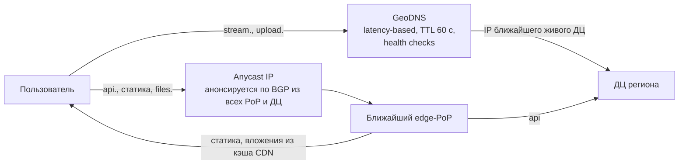
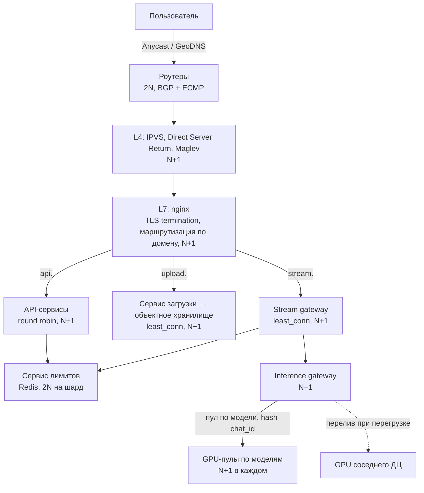
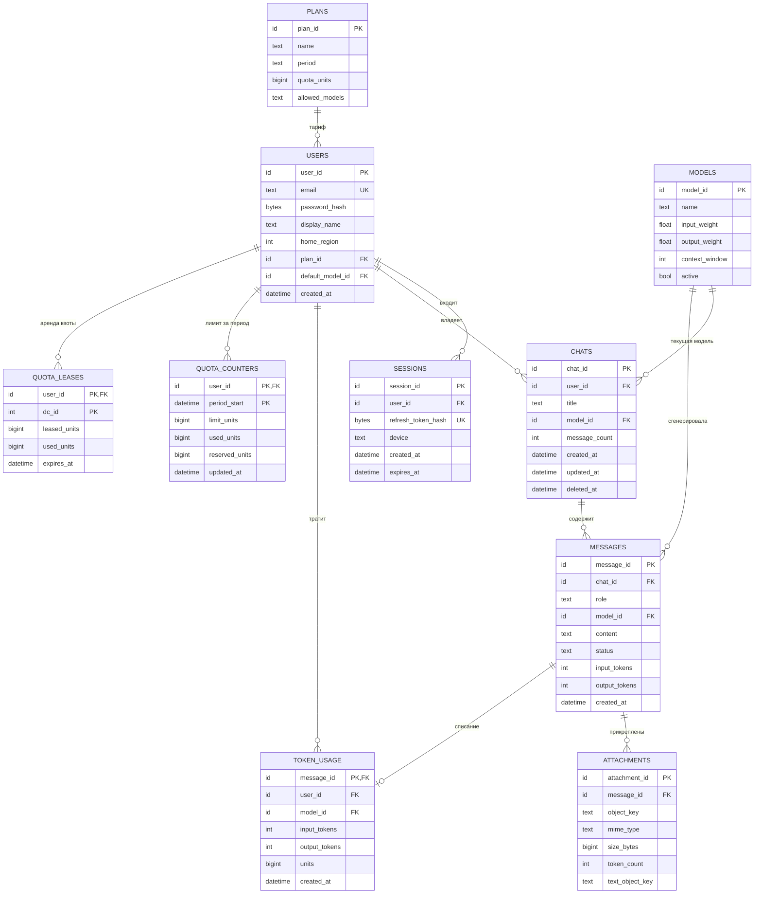
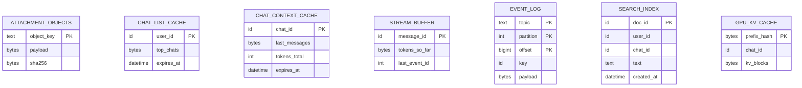
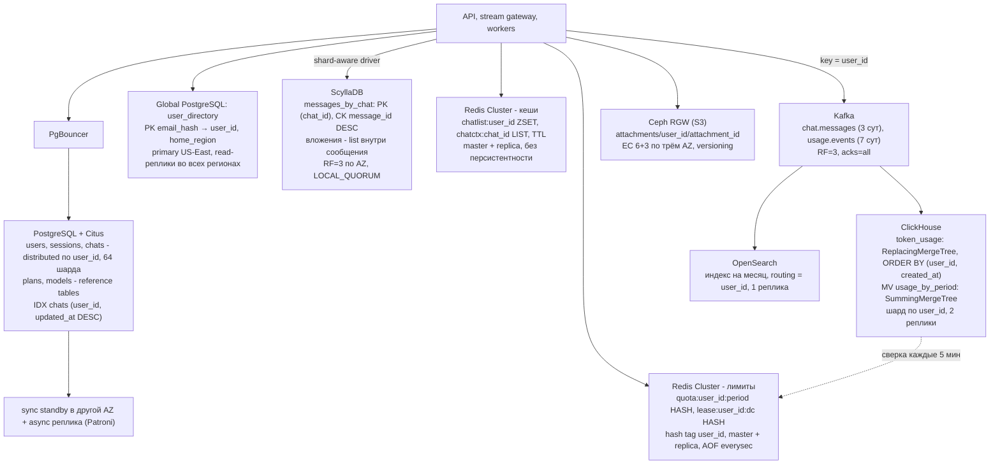

# highloadDZ2026

Домашнее задание по курсу "Проектирование высоконагруженных систем".

## 1. Тема и целевая аудитория

В данной работе будет спроектирована архитектура сервиса-ассистента на базе больших языковых моделей - по образцу Claude от Anthropic. Прямые рыночные аналоги - ChatGPT от OpenAI и Gemini от Google - подтверждают существование ниши и её масштаб: это один из самых быстрорастущих типов потребительских сервисов за последние годы.

Целевая аудитория - массовый пользователь веба и мобильных приложений по всему миру (частные лица и сотрудники компаний). По данным отчёта Sensor Tower "State of AI 2026", у Claude около 245 млн месячных активных пользователей на web и mobile. Такой масштаб аудитории в сочетании с тем, что каждый запрос требует дорогого инференса на GPU (а не просто отдачи статики или строки из БД), делает архитектуру сервиса нетривиальной: нагрузка высока и по RPS на бекенд, и по вычислениям на кластере инференса.

## Функционал MVP

Ключевые функции, вокруг которых будет проектироваться система:

1. Отправка сообщения и потоковое (Token-by-token, TBT) получение ответа модели
2. Хранение истории переписки на сервере и список чатов пользователя
3. Синхронизация чатов между несколькими устройствами одного пользователя
4. Подсчёт токенов запроса и ответа в реальном времени и управление лимитами (квоты на пользователя/чат, остаток лимита, блокировка при превышении)
5. Прикрепление файлов к сообщению (изображения, документы, PDF)
6. Выбор модели под задачу (быстрая и дешёвая vs более мощная и дорогая - напрямую влияет на расход токен-лимита)

## Ключевые продуктовые решения

- История чатов хранится на сервере, а не только на клиенте (в отличие, например, от WhatsApp) - это нужно для синхронизации между устройствами и доступа с любого клиента
- Ответ модели отдаётся потоково через SSE/WebSocket, а не единым блоком по готовности - снижает воспринимаемую задержку (Time to First Byte, TTFB), критичную при долгом инференсе
- Инференс-кластер отделён от основного бекенда и масштабируется независимо: именно GPU-инференс, а не запросы к БД, является главным потребителем ресурсов и основным источником нагрузки
- Лимиты и биллинг считаются в токенах, а не в запросах: у каждого пользователя/чата есть квота на входные+выходные токены за период, и её нужно списывать почти в реальном времени (по мере генерации ответа), а не одной операцией после завершения запроса - это требует быстрого и консистентного учёта расхода под высокой конкурентной нагрузкой

## 2. Расчёт нагрузки

Anthropic не публикует DAU, интенсивность использования, объём хранения и RPS. Сделаем некоторую аппроксимацию - калибруемся по конкуренту (ChatGPT), у которого есть публичные цифры:

- MAU ChatGPT = 1 млрд (июнь 2026, Reuters)
- WAU ChatGPT = >1 млрд (31 июля 2026, подтверждено OpenAI, см. The Information)
- 2.5 млрд запросов/сутки глобально (OpenAI, июль 2025, см. TechCrunch)

Отсюда интенсивность: `2.5 млрд / 1 млрд MAU = 2.5` сообщения в сутки на одного MAU-пользователя - это будет ориентиром. Применяем его к аудитории Claude: `245 млн × 2.5 ≈ 612.5 млн` сообщений в сутки, на одного DAU - `612.5 млн / 49 млн ≈ 12.5`.

Размеры сообщений берём из открытого датасета реальных диалогов ShareChat: запрос в среднем ~135 токенов, ответ ~1 115 токенов, в диалоге с Claude в среднем 4.49 сообщения. Принимаем 1 токен ≈ 4 байта текста (UTF-8, преимущественно латиница).

Остальные допущения - по ним публичных цифр нет даже у ChatGPT:

- DAU/MAU = 20% (в СМИ для ChatGPT называют ~190-210 млн DAU при ~1 млрд MAU - тот же порядок, но это не первоисточник, поэтому используем только как сверку)
- Частота второстепенных действий (список чатов, поиск, вложения, смена модели) задана как пропорция от отправки сообщений
- Пик/среднее = x4 (глобальная аудитория размазывает суточный пик по часовым поясам сильнее, чем у локального сервиса, но вечерние пики US+Европа всё равно накладываются)
- Вложение в среднем 0.5 МБ, каждое просматривается из истории ~2 раза

Основные формулы:

```
DAU                  = MAU × 0.2
Сообщений/сутки      = MAU × 2.5
N_тип/сутки          = DAU × (действий этого типа на пользователя в день)
RPS_средний          = N_тип/сутки / 86 400
RPS_пиковый          = RPS_средний × 4
V_сутки              = N/сутки × размер объекта
Трафик, Гбит/с       = V_сутки × 8 / 86 400
Прирост за год       = V_сутки × 365
Прирост на польз/год = V_сутки × 365 / DAU
```

### Продуктовые метрики

| Метрика                                  | Значение            |
| ---------------------------------------- | ------------------- |
| MAU                                      | 245 млн             |
| DAU                                      | ~49 млн             |
| Прирост хранилища на пользователя за год | ~170 МБ             |
| — сообщения (пары запрос-ответ)          | ~4 560 шт / ~23 МБ  |
| — чаты                                   | ~1 020 шт / ~0.5 МБ |
| — вложения                               | ~290 шт / ~146 МБ   |
| Отправка сообщения                       | ~12.5 шт/день       |
| Открытие списка чатов / истории чата     | ~8 шт/день          |
| Просмотр вложения из истории             | ~1.6 шт/день        |
| Прикрепление файла                       | ~0.8 шт/день        |
| Смена модели                             | ~0.5 шт/день        |
| Поиск по истории                         | ~0.3 шт/день        |

### Хранение (суточный прирост)

Для хранения важнее не накопленный объём на пользователя, а скорость прироста:

- Сообщения: `612.5 млн × (135 + 1 115) токенов × 4 Б ≈ 612.5 млн × 5 КБ ≈ 3.06 ТБ/сутки`
- Чаты: `612.5 млн / 4.49 ≈ 136 млн` новых чатов в сутки, метаданные ~0.5 КБ
- Учёт токенов: одна запись на запрос (user_id, chat_id, модель, input/output токены, время) ~100 Б
- Вложения: `49 млн × 0.8 × 0.5 МБ ≈ 19.6 ТБ/сутки`

| Тип данных           | Объектов/сутки | Объём/сутки | Прирост/год |
| -------------------- | -------------- | ----------- | ----------- |
| Сообщения            | 612.5 млн      | ~3.06 ТБ    | ~1.1 ПБ     |
| Метаданные чатов     | 136 млн        | ~0.07 ТБ    | ~25 ТБ      |
| Записи учёта токенов | 612.5 млн      | ~0.06 ТБ    | ~22 ТБ      |
| Вложения             | 39.2 млн       | ~19.6 ТБ    | ~7.2 ПБ     |
| Итого                | -              | ~22.8 ТБ    | ~8.3 ПБ     |

### Токены (нагрузка на учёт лимитов и инференс)

На вход модели уходит не только новое сообщение, но и история чата: в среднем перед сообщением в чате `(4.49 - 1) / 2 ≈ 1.75` предыдущих пар, т.е. `135 + 1.75 × 1 250 ≈ 2 325` входных токенов на запрос.

| Тип токенов               | Среднее, токенов/с | Пик, токенов/с |
| ------------------------- | ------------------ | -------------- |
| Входные (с историей чата) | ~16.5 млн          | ~66 млн        |
| Выходные                  | ~7.9 млн           | ~31.6 млн      |

### Сетевой трафик

- Стриминг ответа: SSE-событие на ~4 токена, ~100 Б обвязки на событие → `1 115 / 4 × 100 Б + 4.5 КБ ≈ 32.5 КБ`, плюс запрос ~1.5 КБ ⇒ ~34 КБ на сообщение
- Список чатов / история чата: ~10 КБ (gzip)
- Вложения раздаются через CDN

| Тип трафика            | Объём/сутки | Средний, Гбит/с | Пиковый, Гбит/с |
| ---------------------- | ----------- | --------------- | --------------- |
| Стриминг сообщений     | ~20.8 ТБ    | ~1.9            | ~7.7            |
| Загрузка вложений      | ~19.6 ТБ    | ~1.8            | ~7.3            |
| Раздача вложений (CDN) | ~39.2 ТБ    | ~3.6            | ~14.5           |
| Список чатов / история | ~3.9 ТБ     | ~0.4            | ~1.5            |
| Итого                  | ~83.5 ТБ    | ~7.7            | ~31             |

### RPS по типам запросов

| Тип запроса                          | Запросов/сутки | RPS средний | RPS пиковый |
| ------------------------------------ | -------------- | ----------- | ----------- |
| Отправка сообщения (chat completion) | 612.5 млн      | ~7 090      | ~28 360     |
| Проверка/списание токен-лимита\*     | 612.5 млн      | ~7 090      | ~28 360     |
| Список чатов / история               | 392 млн        | ~4 540      | ~18 160     |
| Просмотр вложения (CDN)              | 78.4 млн       | ~910        | ~3 640      |
| Прикрепление файла                   | 39.2 млн       | ~450        | ~1 800      |
| Смена модели                         | 24.5 млн       | ~280        | ~1 120      |
| Поиск по истории                     | 14.7 млн       | ~170        | ~680        |

\* внутренний запрос, привязан 1:1 к отправке сообщения (списывается по мере стриминга ответа)

## 3. Глобальная балансировка нагрузки

### Функциональное разбиение по доменам

| Домен                      | Назначение                                                 | Балансировка |
| -------------------------- | ---------------------------------------------------------- | ------------ |
| `assistant.example`        | Веб-клиент, статика                                        | CDN, Anycast |
| `api.assistant.example`    | Список чатов, история, поиск, смена модели, остаток лимита | Anycast      |
| `stream.assistant.example` | Отправка сообщения и SSE-стриминг ответа                   | GeoDNS       |
| `upload.assistant.example` | Загрузка вложений                                          | GeoDNS       |
| `files.assistant.example`  | Раздача вложений                                           | CDN, Anycast |

Короткие stateless-запросы (`api`, статика, файлы) идут через Anycast: смена BGP-маршрута посреди запроса им почти не страшна. Долгие соединения (`stream` - ~20 с на ответ, `upload`) идут через GeoDNS, чтобы соединение гарантированно оставалось в одном ДЦ.

### Расположение ДЦ

По данным Anthropic Economic Index на США приходится 21.6% использования Claude.ai, дальше идут Индия (~7%), Бразилия, Япония и Южная Корея (по ~3.5%); использование сильно коррелирует с ВВП на душу населения, поэтому значимая доля - у Европы. Точного разбиения по регионам нет, поэтому доли ниже - оценка:

| ДЦ                  | Обслуживаемые регионы                      | Доля (оценка) |
| ------------------- | ------------------------------------------ | ------------- |
| US-East (Вирджиния) | Восток Северной Америки, Латинская Америка | 25%           |
| US-West (Орегон)    | Запад Северной Америки                     | 11%           |
| Франкфурт           | Европа, Ближний Восток, Африка             | 34%           |
| Сингапур            | Южная и Юго-Восточная Азия, Океания        | 18%           |
| Токио               | Восточная Азия                             | 12%           |

Обоснование:

- GPU-кластеры требуют много электроэнергии, поэтому ставим крупные ДЦ в пяти регионах, а не в каждой стране; ближе к пользователям - edge-PoP (CDN и TLS-терминация)
- Влияние на продуктовые метрики: трансокеанский RTT 150-250 мс против <50 мс внутри региона добавляется ко времени до первого токена (TTFT) и особенно заметен на запросах `api` (открытие списка чатов, истории). Сам стриминг от RTT почти не зависит
- Европа выделена отдельно ещё и из-за GDPR: чаты пользователей ЕС хранятся в ЕС
- Латинская Америка обслуживается из US-East (~120 мс до Сан-Паулу - приемлемо для LLM-сервиса), статика - с локального edge-PoP

### Распределение запросов по ДЦ (пик)

`Пик_ДЦ = Пик_глобальный × доля ДЦ`. Трафик через ДЦ - без раздачи вложений (её берёт на себя CDN): `7.7 + 7.3 + 1.5 ≈ 16.4 Гбит/с`.

| ДЦ        | Отправка сообщения | Список чатов / история | Загрузка файлов | Трафик, Гбит/с |
| --------- | ------------------ | ---------------------- | --------------- | -------------- |
| US-East   | 7 090              | 4 540                  | 450             | ~4.1           |
| US-West   | 3 120              | 2 000                  | 200             | ~1.8           |
| Франкфурт | 9 640              | 6 170                  | 610             | ~5.6           |
| Сингапур  | 5 100              | 3 270                  | 320             | ~3.0           |
| Токио     | 3 400              | 2 180                  | 220             | ~2.0           |

### Схема DNS и Anycast балансировки



### Регулировка трафика между ДЦ

- Отключение ДЦ (авария или работы): снимаем BGP-анонс Anycast-адресов и убираем ДЦ из ответов GeoDNS - за ~TTL (60 с) новые соединения уходят в соседний ДЦ
- Перелив инференса: если в ДЦ перегружены GPU (растёт очередь, нарушается SLO по TTFT), inference gateway отправляет генерацию в соседний ДЦ по магистральной сети - лишние ~100 мс незаметны на фоне ~20 с генерации. Тяжёлые модели могут быть развёрнуты не во всех ДЦ - тогда запрос маршрутизируется туда, где модель есть
- Токен-лимиты: счётчик квоты пользователя живёт в его "домашнем" регионе. Чтобы не ходить через океан на каждое сообщение, ДЦ берёт у домашнего региона "аренду" части остатка квоты (например, 10%) и списывает локально; неизрасходованное возвращается асинхронно. Возможное превышение лимита ограничено размером аренды

## 4. Локальная балансировка нагрузки

### Схема балансировки



| Уровень                | Резервирование                | Почему                                                                                 |
| ---------------------- | ----------------------------- | -------------------------------------------------------------------------------------- |
| Роутеры                | 2N                            | Отказ роутера отключает весь ДЦ                                                        |
| L4 (IPVS)              | N+1                           | Узлы взаимозаменяемы; Maglev даёт одинаковый выбор L7 на всех L4, соединения не рвутся |
| L7 (nginx)             | N+1                           | Отказ узла снижает только общую мощность                                               |
| API, stream gateway    | N+1                           | То же                                                                                  |
| Сервис лимитов (Redis) | 2N (мастер + реплика на шард) | Потеря счётчика = либо бесплатные токены, либо ложные блокировки                       |
| GPU-пулы               | N+1 на каждую модель          | Отказ узла не должен делать модель недоступной                                         |

Алгоритмы: роутеры → L4 - ECMP; L4 → L7 - Maglev (consistent hashing по 5-tuple); `api` - round robin (короткие запросы); `stream` и `upload` - least_conn (долгие соединения); inference gateway → GPU - сначала пул нужной модели, внутри пула hash по `chat_id` (переиспользование KV/prefix-кэша истории чата), при перегрузке узла - узел с наименьшей очередью.

### Расчёт количества балансировщиков

Пиковый внешний RPS через L7 (без CDN и внутренней проверки лимитов): `28 360 + 18 160 + 1 800 + 1 120 + 680 ≈ 50 120`. Оценка сверху - каждый запрос открывает новое TLS-соединение.

- SSL termination, данные 2017 г. (RSA-2048): 428 CPS на ядро; масштабирование упирается в ~10 000 CPS на сервер (24 ядра) ⇒ `50 120 / 428 ≈ 117` ядер глобально
- SSL termination, данные 2019 г.: 4 433 TPS на ядро ⇒ `50 120 / 4 433 ≈ 12` ядер - считаем по более строгим данным 2017 г.
- Обработка HTTPS-запросов (1 КБ): 28 640 RPS на ядро ⇒ ~2 ядра - не ограничитель
- Одновременные SSE-стримы: ответ длится `1 115 токенов / ~60 токенов/с + ~1 с TTFT ≈ 20 с` ⇒ `28 360 × 20 ≈ 570 тыс.` открытых соединений глобально (во Франкфурте ~190 тыс.). nginx держит сотни тысяч соединений на сервер - не ограничитель, но `worker_connections` нужно поднять
- Сеть: максимум во Франкфурте ~5.6 Гбит/с, сервер с 25 GbE при загрузке 70% - 17.5 Гбит/с - не ограничитель
- L4 в режиме DSR пропускает только входящий трафик (запросы и загрузки, ~7.6 Гбит/с глобально) - не ограничитель, ставим по 2 на ДЦ

`Серверов nginx = ⌈Пиковый RPS ДЦ / 10 000⌉ + 1`

| ДЦ        | Пиковый RPS | Ядер на TLS | Серверов nginx | Серверов L4 | Роутеров |
| --------- | ----------- | ----------- | -------------- | ----------- | -------- |
| US-East   | 12 530      | 30          | 3 (+1)         | 2           | 2        |
| US-West   | 5 510       | 13          | 2              | 2           | 2        |
| Франкфурт | 17 040      | 40          | 3 (+1)         | 2           | 2        |
| Сингапур  | 9 020       | 22          | 2              | 2           | 2        |
| Токио     | 6 010       | 15          | 2              | 2           | 2        |

US-East и Франкфурт резервируют друг друга: при отказе одного второй получает `12 530 + 17 040 ≈ 29 600 RPS` ⇒ 3 рабочих сервера, поэтому для сохранения N+1 в аварии добавляем им по одному серверу (+1). Итого: 14 серверов nginx, 10 серверов L4, 10 роутеров.

## 5. Логическая схема БД

ID всех сущностей - 64-битные Snowflake-идентификаторы (время + номер региона + счётчик): они упорядочены по времени создания, а по `user_id` сразу видно домашний регион пользователя. Все данные пользователя хранятся в его домашнем регионе (см. GDPR в части 3). Объёмы считаются на горизонте 1 год, как прирост в части 2.

### 5.1. Основные сущности



Лимит считается в условных единицах: `units = input_tokens × input_weight + output_tokens × output_weight`. Веса берутся из `MODELS`, поэтому сообщение мощной модели "стоит" больше - так выбор модели напрямую влияет на расход лимита.

| Таблица          | Назначение                                                                                          |
| ---------------- | --------------------------------------------------------------------------------------------------- |
| `USERS`          | Аккаунт, тариф, домашний регион, модель по умолчанию                                                |
| `SESSIONS`       | Refresh-токены устройств; access-токен (JWT) живёт 15 мин и БД не читает                            |
| `PLANS`          | Тарифы: размер квоты, период (окно 5 ч / неделя), доступные модели. Справочник, ~10 строк          |
| `MODELS`         | Модели и их веса для пересчёта токенов в единицы лимита. Справочник, ~20 строк                     |
| `CHATS`          | Чат: заголовок, текущая модель, время последнего сообщения (сортировка в боковой панели)           |
| `MESSAGES`       | Сообщения пользователя и ответы модели с числом токенов; `status` = streaming / complete / error   |
| `ATTACHMENTS`    | Метаданные вложения; сам файл и извлечённый из него текст лежат в объектном хранилище              |
| `TOKEN_USAGE`    | Журнал списаний: одна запись на ответ модели. Источник истины для биллинга и сверки счётчиков      |
| `QUOTA_COUNTERS` | Текущий расход лимита пользователя за период: использовано + зарезервировано под идущие генерации  |
| `QUOTA_LEASES`   | "Аренда" части квоты чужим ДЦ (см. часть 3)                                                          |

### 5.2. Файлы, кеши и буферы



| Данные               | Назначение                                                                                                         |
| -------------------- | ------------------------------------------------------------------------------------------------------------------ |
| `ATTACHMENT_OBJECTS` | Байты вложений и извлечённый из PDF/документов текст (его читает модель); связь по `object_key` из `ATTACHMENTS`   |
| `CHAT_LIST_CACHE`    | Последние 50 чатов пользователя для боковой панели                                                                 |
| `CHAT_CONTEXT_CACHE` | Хвост истории активного чата - нужен на каждое новое сообщение, чтобы собрать запрос к модели; TTL 1 ч             |
| `STREAM_BUFFER`      | Уже сгенерированная часть ответа - чтобы клиент при обрыве переподключился и дочитал (`Last-Event-ID`)              |
| `EVENT_LOG`          | Очередь событий: сообщения (для поиска и восстановления), списания токенов (для журнала `TOKEN_USAGE`)             |
| `SEARCH_INDEX`       | Полнотекстовый индекс по названиям чатов и сообщениям пользователя                                                 |
| `GPU_KV_CACHE`       | Обработанная моделью история чата в памяти GPU; не хранится постоянно, теряется без последствий                    |

Продуктовое решение для поиска: индексируем только названия чатов и сообщения пользователя, без ответов модели. Ответы в ~8 раз длиннее, и индекс по ним стоил бы ~1 ПБ в год, а найти чат почти всегда можно по своему вопросу.

### 5.3. Размеры и нагрузка

Допущения (в дополнение к части 2):

- Аккаунтов ~500 млн (~2×MAU, много неактивных), активных сессий ~370 млн (~1.5 устройства на MAU)
- Открытия списка чатов и истории чата (8/день на DAU) делятся пополам: пик по 9 080/с
- Новых чатов `612.5 млн / 4.49 ≈ 136 млн/сутки` → пик ~6 300/с; обновление токена - 2 раза в день на DAU → пик ~4 540/с
- Списание лимита во время стриминга - каждые ~256 выходных токенов: `1 115 / 256 ≈ 4.4` раза за ответ, плюс резерв до генерации и итоговое списание после
- Попадание в кеш: список чатов и чат - 80%, история чата - 50%, контекст для генерации - 80% (у первого сообщения чата - 22% всех сообщений - контекста нет)

Нагрузка - глобальный пик (×4 от среднего).

| Таблица          | Строк (1 год) | Байт/строка | Объём      | Чтение, QPS | Запись, QPS |
| ---------------- | ------------- | ----------- | ---------- | ----------- | ----------- |
| `USERS`          | 500 млн       | 300         | 0.15 ТБ    | 4 540       | 1 150       |
| `SESSIONS`       | 370 млн       | 200         | 0.07 ТБ    | 4 540       | 4 540       |
| `PLANS`, `MODELS`| ~30           | 200         | ~6 КБ      | <10         | ~0          |
| `CHATS`          | 49.6 млрд     | 500         | 24.8 ТБ    | 3 640       | 42 080      |
| `MESSAGES`       | 447 млрд      | 2 500       | 1.12 ПБ    | 8 960       | 56 720      |
| `ATTACHMENTS`    | 14.3 млрд     | 200         | 2.9 ТБ     | (с сообщениями) | 1 800   |
| `TOKEN_USAGE`    | 224 млрд      | 100         | 22.4 ТБ    | 230         | 28 360      |
| `QUOTA_COUNTERS` | 245 млн       | 64          | 16 ГБ      | 9 080       | 181 500     |
| `QUOTA_LEASES`   | ~1 млн        | 64          | 64 МБ      | 600         | 600         |

Откуда цифры:

- `USERS`: чтение при входе и обновлении токена (4 540), запись - смена модели по умолчанию (1 120) и регистрации (~25)
- `CHATS`: запись = новый чат 6 300 + обновление `updated_at` и счётчика на каждое сообщение 28 360 + автоматический заголовок 6 300 + смена модели 1 120. Чтение = `(9 080 + 9 080) × 20%` промахов кеша
- `MESSAGES`: две строки на обмен (вопрос и ответ) `2 × 28 360 = 56 720`. Чтение = история `9 080 × 50%` + контекст для генерации `28 360 × 78% × 20%` ≈ 8 960 запросов (каждый - выборка ~10 строк)
- `TOKEN_USAGE`: одна запись на ответ; чтение - страница расхода у пользователя, плюс фоновая сверка
- `QUOTA_COUNTERS`: `28 360 × (1 резерв + 4.4 списания + 1 итог) ≈ 181 500` атомарных операций/с. Это самая нагруженная на запись сущность - но строка маленькая и вся таблица помещается в память

| Файлы / кеши / буферы | Количество и размер                         | Объём           | Пиковое чтение / запись                       |
| --------------------- | ------------------------------------------- | --------------- | --------------------------------------------- |
| `ATTACHMENT_OBJECTS`  | 14.3 млрд × 0.5 МБ + извлечённый текст ~20 КБ | ~7.4 ПБ/год     | GET с origin ~3 600/с (промахи CDN + чтение текста моделью); PUT ~3 600/с |
| `CHAT_LIST_CACHE`     | 49 млн DAU × 5 КБ                           | ~245 ГБ         | 9 080 / ~41 000                               |
| `CHAT_CONTEXT_CACHE`  | ~50 млн чатов, активных за час, × 10 КБ     | ~500 ГБ         | 28 360 / 56 720                               |
| `STREAM_BUFFER`       | 570 тыс. одновременных ответов × 5 КБ       | ~2.9 ГБ         | дописывается в памяти gateway                 |
| `EVENT_LOG`           | сообщения - 3 сут, списания - 7 сут         | ~10 ТБ          | 56 720 + 28 360 событий/с                     |
| `SEARCH_INDEX`        | `(612.5 млн × 0.6 КБ + 136 млн × 0.1 КБ) × 1.5` в сутки | ~210 ТБ/год | 680 / 34 660 документов/с          |
| `GPU_KV_CACHE`        | в памяти GPU-узлов                          | -               | на каждую генерацию                           |

Все объёмы логические, без реплик и индексов (физические - в части 6).

### 5.4. Консистентность и распределение нагрузки по ключам

| Данные                        | Требование к консистентности                                                                                                     | Распределение нагрузки по ключам                                                                                  |
| ----------------------------- | -------------------------------------------------------------------------------------------------------------------------------- | ----------------------------------------------------------------------------------------------------------------- |
| `USERS`, `SESSIONS`           | Строгая: уникальный email, отзыв сессии действует сразу                                                                          | Равномерно по `user_id`                                                                                           |
| `QUOTA_COUNTERS`              | Строгая на ключ: резерв и списание атомарны, потерянных обновлений нет. Допустимый перерасход - не больше одного резерва + аренды | По `user_id`. Горячий ключ = активный пользователь, но его нагрузку сверху ограничивает сам лимит                |
| `TOKEN_USAGE`                 | Итоговая (отставание - секунды), но без потерь и дублей: доставка at-least-once + идемпотентность по `message_id`                 | По `user_id`, только добавление                                                                                    |
| `MESSAGES`, `CHATS`           | Read-your-writes для автора (своё сообщение видно сразу); на другом устройстве - итоговая, до 1-2 с. Порядок в чате - по `message_id`; в одном чате одновременно идёт одна генерация | По `chat_id` / `user_id`. Размер одного чата ограничен окном контекста модели (~200 тыс. токенов ≈ 1 МБ) - "бесконечно горячих" чатов нет |
| `ATTACHMENTS` + файлы         | Файл записывается до метаданных; сообщение с вложением появляется только после записи файла. Неотправленные файлы удаляются через 24 ч | Ключ объекта неизменяемый, распределение по хешу                                                                  |
| Кеши                          | Итоговая: контекст чата обновляется сразу после записи сообщения в БД, список чатов - с TTL                                       | По `user_id` / `chat_id`                                                                                          |
| `SEARCH_INDEX`                | Итоговая, отставание до ~1 мин                                                                                                   | По `user_id`: поиск всегда внутри своих чатов                                                                      |

Общие особенности распределения:

- Все записи идут "в текущий момент" - поэтому шардировать по времени нельзя (весь поток записи попал бы на один шард). Шардируем по хешу `user_id` / `chat_id`, а время используем только для удаления старых данных
- Нагрузка по регионам повторяет доли из части 3: Франкфурт хранит и обслуживает ~34% данных
- Справочники `PLANS` и `MODELS` читаются на каждый запрос, поэтому держатся в памяти сервисов

## 6. Физическая схема БД

### 6.1. Выбор СУБД

| Данные                                    | СУБД                     | Почему                                                                                                                                       |
| ----------------------------------------- | ------------------------ | -------------------------------------------------------------------------------------------------------------------------------------------- |
| `USERS`, `SESSIONS`, `CHATS`, справочники | PostgreSQL + Citus       | Нужны транзакции, уникальность email и индекс с сортировкой по изменяемому полю (`updated_at` для списка чатов). Citus шардирует таблицы по `user_id` |
| `MESSAGES` (+ вложения внутри)            | ScyllaDB                 | Самая большая таблица (~1.1 ПБ/год) и ~57 тыс. вставок/с; доступ только по ключу `chat_id` без JOIN. Широкие строки отсортированы по `message_id`. Так же хранит сообщения Discord |
| `QUOTA_COUNTERS`, `QUOTA_LEASES`          | Redis Cluster (отдельный, с AOF) | ~180 тыс. атомарных операций/с при объёме 16 ГБ: всё в памяти, атомарность через Lua-скрипт на одном шарде                         |
| Кеши                                      | Redis Cluster (отдельный) | Отдельный кластер, чтобы вытеснение кеша не трогало счётчики лимитов                                                                       |
| `TOKEN_USAGE`                             | ClickHouse               | Журнал только на добавление, агрегаты по пользователю и периоду, сжатие ×5-10                                                               |
| `EVENT_LOG`                               | Kafka                    | Надёжная очередь с повторным чтением                                                                                                          |
| `SEARCH_INDEX`                            | OpenSearch               | Полнотекстовый поиск                                                                                                                          |
| `ATTACHMENT_OBJECTS`                      | Ceph (S3 API)            | Объектное хранилище на петабайты, erasure coding                                                                                             |
| `STREAM_BUFFER`                           | Память stream gateway    | Буфер на ~20 с; восстановление при обрыве - через переподключение к тому же gateway (hash по `message_id`)                                   |

### 6.2. Схема

Каждая СУБД развёрнута в каждом регионе отдельно и хранит данные пользователей этого региона. Регион состоит из трёх зон доступности (AZ) - отдельных зданий с независимым питанием. Единственная глобальная таблица - `user_directory` (по ней при входе определяется домашний регион).



### 6.3. Таблицы, индексы, шардирование и резервирование

Ключевые определения:

```sql
-- PostgreSQL + Citus
CREATE TABLE chats (
    user_id bigint, chat_id bigint, title text, model_id int,
    message_count int, created_at timestamptz, updated_at timestamptz, deleted_at timestamptz,
    PRIMARY KEY (user_id, chat_id)
);
SELECT create_distributed_table('chats', 'user_id');
CREATE INDEX chats_recent ON chats (user_id, updated_at DESC) WHERE deleted_at IS NULL;

-- ScyllaDB
CREATE TABLE messages_by_chat (
    chat_id bigint, message_id bigint, user_id bigint, role text, model_id int,
    content text, status text, input_tokens int, output_tokens int,
    attachments list<frozen<attachment>>,
    PRIMARY KEY ((chat_id), message_id)
) WITH CLUSTERING ORDER BY (message_id DESC);

-- ClickHouse
CREATE TABLE token_usage (
    message_id UInt64, user_id UInt64, model_id UInt16,
    input_tokens UInt32, output_tokens UInt32, units UInt64, created_at DateTime
) ENGINE = ReplicatedReplacingMergeTree
PARTITION BY toYYYYMM(created_at) ORDER BY (user_id, created_at, message_id);
```

| Таблица                   | СУБД, индексы                                                                                           | Шардирование                                     | Резервирование                                            |
| ------------------------- | ------------------------------------------------------------------------------------------------------- | ------------------------------------------------ | --------------------------------------------------------- |
| `users`                   | Citus: PK `user_id`; UNIQUE `email`                                                                     | hash `user_id`, 64 шарда на регион               | Primary + sync standby (другая AZ) + async реплика        |
| `sessions`                | Citus: PK `(user_id, session_id)`; UNIQUE `(user_id, refresh_token_hash)`; IDX `expires_at` для очистки | hash `user_id` (`user_id` зашит в refresh-токен) | То же                                                     |
| `chats`                   | Citus: PK `(user_id, chat_id)`; IDX `(user_id, updated_at DESC) WHERE deleted_at IS NULL`               | hash `user_id`, колокация с `users`              | То же                                                     |
| `plans`, `models`         | Citus reference tables                                                                                  | Полная копия на каждом узле                      | Вместе с кластером                                        |
| `user_directory`          | Глобальный PostgreSQL: PK `email_hash`                                                                  | Без шардирования (~500 млн × 50 Б = 25 ГБ)      | Primary + sync standby в US-East, read-реплики в регионах |
| `messages_by_chat`        | ScyllaDB: partition `chat_id`, clustering `message_id DESC`                                             | Murmur3-кольцо по `chat_id`                      | RF=3, по реплике в каждой AZ; LOCAL_QUORUM                |
| `quota`, `lease`          | Redis: HASH, ключи с hash tag `{user_id}`                                                               | 16 384 hash slot                                 | Master + replica в другой AZ (2N), AOF everysec           |
| `chatlist`, `chatctx`     | Redis: ZSET по `updated_at`, LIST последних сообщений                                                   | hash slot                                        | Master + replica, без персистентности                     |
| `token_usage`             | ClickHouse: ORDER BY `(user_id, created_at, message_id)`; MV `usage_by_period`                          | `cityHash64(user_id)`                            | ReplicatedMergeTree, 2 реплики в разных AZ                |
| `chat.messages`, `usage.events` | Kafka, key = `user_id`                                                                            | 128 партиций                                     | RF=3, `min.insync.replicas=2`                             |
| `search`                  | OpenSearch: индекс на месяц, поля `user_id`, `chat_id`, `text`                                          | routing = `user_id` (поиск бьёт в один шард)     | 1 реплика                                                 |
| `attachments/*`           | Ceph RGW, ключ `attachments/{user_id}/{attachment_id}`                                                  | CRUSH-хеш по объекту                             | Erasure coding 6+3 по трём AZ (по 3 фрагмента в AZ)       |

Физические объёмы за год (все регионы): ScyllaDB `1.12 ПБ × RF 3 / сжатие ~2 ≈ 1.7 ПБ`; Citus `~28 ТБ × 2 (индексы) × 3 копии ≈ 170 ТБ`; ClickHouse `22.4 ТБ / 5 × 2 ≈ 9 ТБ`; Ceph `7.4 ПБ × 9/6 ≈ 11 ПБ`; OpenSearch `210 ТБ × 2 ≈ 420 ТБ`; Redis ~1.5 ТБ памяти. EC 6+3 при потере целой AZ теряет 3 фрагмента из 9 и всё ещё читает данные.

### 6.4. Денормализация

- `messages_by_chat` хранит `user_id` (проверка доступа без чтения чата), `model_id` и токены (без JOIN с журналом), а вложения - списком прямо в строке сообщения: история чата отдаётся одним запросом к одной партиции. Отдельной таблицы вложений физически нет: скачивание идёт по подписанной ссылке, которой БД не нужна
- `chats` хранит `updated_at` и `message_count` - чтобы боковая панель строилась по индексу, а не подсчётом сообщений
- `quota` в Redis - это агрегат `TOKEN_USAGE` за текущий период, а лимит тарифа скопирован в тот же HASH, чтобы проверка шла одной операцией без чтения `plans`
- `usage_by_period` в ClickHouse - заранее посчитанные суммы для страницы расхода и сверки
- `user_directory` - глобальная копия связки email → регион, чтобы при входе не опрашивать все регионы

### 6.5. Клиентские библиотеки и балансировка подключений

Бекенд на Go.

| Хранилище       | Библиотека                     | Балансировка / мультиплексирование                                                                                       |
| --------------- | ------------------------------ | ------------------------------------------------------------------------------------------------------------------------ |
| PostgreSQL/Citus| `pgx/v5` + `pgxpool`           | PgBouncer в режиме transaction pooling: тысячи соединений приложений сводятся к сотням соединений с БД. Запись и чтение сразу после записи - в primary, остальное чтение - в реплику |
| ScyllaDB        | `scylladb/gocql` (shard-aware) | Драйвер сам знает, какой узел и какое ядро владеют ключом, и шлёт запрос прямо туда, без прокси; `LOCAL_QUORUM` на запись и чтение (`R + W > RF` - чтение видит свою запись) |
| Redis           | `redis/go-redis` (ClusterClient)| Клиент держит карту hash slot → master и ходит напрямую; pipeline для пачек операций; счётчики - только с master        |
| Kafka           | `twmb/franz-go`                | Идемпотентный producer, батчинг; запись в leader партиции                                                               |
| ClickHouse      | `clickhouse-go/v2`             | Только пачечная вставка из Kafka (не по строке); чтение через chproxy                                                   |
| OpenSearch      | `opensearch-go`                | Coordinating-узлы за внутренним балансировщиком; routing по `user_id`                                                   |
| Ceph RGW        | AWS SDK for Go v2 (S3)         | Несколько RGW за внутренним L4, пул keep-alive соединений                                                                |

Списание лимита - Lua-скрипт в Redis: проверить остаток, зарезервировать, списать - атомарно на одном шарде. Каждая генерация параллельно пишет событие в `usage.events`, и раз в 5 минут счётчики сверяются с ClickHouse. Если Redis при переключении на реплику потерял последнюю секунду списаний, сверка вернёт их.

### 6.6. Резервное копирование

| Компонент        | Как                                                                                                                         | Хранение и восстановление                                                                 |
| ---------------- | --------------------------------------------------------------------------------------------------------------------------- | ----------------------------------------------------------------------------------------- |
| PostgreSQL/Citus | pgBackRest: полный бэкап раз в неделю, инкрементальный раз в сутки, непрерывный архив WAL; согласованные точки восстановления Citus | 30 суток; восстановление на любой момент (PITR). Копии лежат в другом регионе той же юрисдикции (данные ЕС - в ЕС) |
| ScyllaDB         | Scylla Manager: снимок раз в сутки + выгрузка новых SSTable                                                                 | 30 суток; события из `chat.messages` за последние 3 суток досылаются после восстановления |
| Redis - лимиты   | RDB раз в час + AOF                                                                                                         | При полной потере счётчики пересобираются из ClickHouse `usage_by_period`                 |
| Redis - кеши     | Не бэкапится                                                                                                                | Прогревается из БД                                                                        |
| ClickHouse       | `clickhouse-backup` раз в сутки в объектное хранилище                                                                       | 1 год (биллинговые данные)                                                                |
| Kafka            | Не бэкапится - это буфер (RF=3)                                                                                             | -                                                                                         |
| OpenSearch       | Снимки раз в сутки                                                                                                          | Можно пересобрать из ScyllaDB                                                             |
| Ceph             | EC 6+3 по трём AZ + versioning: удалённые файлы хранятся 30 суток                                                           | Отдельной копии в другом регионе нет - сознательно: это +7 ПБ в год, а потеря всех трёх AZ региона маловероятна |

Реплика не заменяет бэкап: ошибочное удаление мгновенно попадает на все реплики, поэтому бэкапы хранятся отдельно, с отдельными правами доступа. Раз в месяц - пробное восстановление.

## Источники

- [Sensor Tower — State of AI 2026](https://sensortower.com/blog/state-of-ai-2026) - оценка MAU Claude (245 млн web+mobile) и динамика роста
- [TechCrunch — Anthropic's Claude is winning over paid consumers](https://techcrunch.com/2026/06/25/anthropics-claude-is-winning-over-paid-consumers-a-market-owned-by-chatgpt/) - независимое подтверждение роста аудитории и выручки на основе данных Sensor Tower
- [The Information — OpenAI's ChatGPT nears 1 billion weekly active users](https://www.theinformation.com/articles/openais-chatgpt-nears-1-billion-weekly-active-users-seven-months-target) - официальное подтверждение OpenAI: >1 млрд WAU на 31 июля 2026, 900 млн в феврале 2026
- [TechCrunch — ChatGPT users send 2.5 billion prompts a day](https://techcrunch.com/2025/07/21/chatgpt-users-send-2-5-billion-prompts-a-day/) - интенсивность использования (запросов/сутки), источник ориентира для сообщ./пользователя/день
- [ShareChat: A Dataset of Chatbot Conversations in the Wild](https://github.com/raye22/ShareChat) - средний размер запроса/ответа в токенах, среднее число сообщений в диалоге с Claude
- [Anthropic Economic Index — geography](https://www.anthropic.com/research/economic-index-geography) - распределение использования Claude.ai по странам
- [Testing the Performance of NGINX and NGINX Plus Web Servers (2017)](https://blog.nginx.org/blog/testing-the-performance-of-nginx-and-nginx-plus-web-servers) - CPS для HTTPS
- [Testing the Performance of NGINX Ingress Controllers in Kubernetes (2019)](https://blog.nginx.org/blog/testing-performance-nginx-ingress-controller-kubernetes) - TLS TPS и HTTPS RPS
- [Discord — How Discord Stores Trillions of Messages](https://discord.com/blog/how-discord-stores-trillions-of-messages) - хранение сообщений в ScyllaDB с партицией по каналу
- [ScyllaDB — CQL drivers](https://opensource.docs.scylladb.com/stable/using-scylla/drivers/cql-drivers/index.html) - shard-aware драйверы
- [Citus — Choosing distribution column](https://docs.citusdata.com/en/stable/sharding/data_modeling.html) - шардирование PostgreSQL по ключу
- [Redis — Scale with Redis Cluster](https://redis.io/docs/latest/operate/oss_and_stack/management/scaling/) - hash slots и реплики
- [ClickHouse — MergeTree](https://clickhouse.com/docs/engines/table-engines/mergetree-family/mergetree) - движок журнала токенов
- [Ceph — Erasure code](https://docs.ceph.com/en/latest/rados/operations/erasure-code/) - EC для вложений
- [PostgreSQL — Log-Shipping Standby Servers](https://www.postgresql.org/docs/current/warm-standby.html) - репликация
- [pgBackRest — User Guide](https://pgbackrest.org/user-guide.html) - бэкапы и PITR
